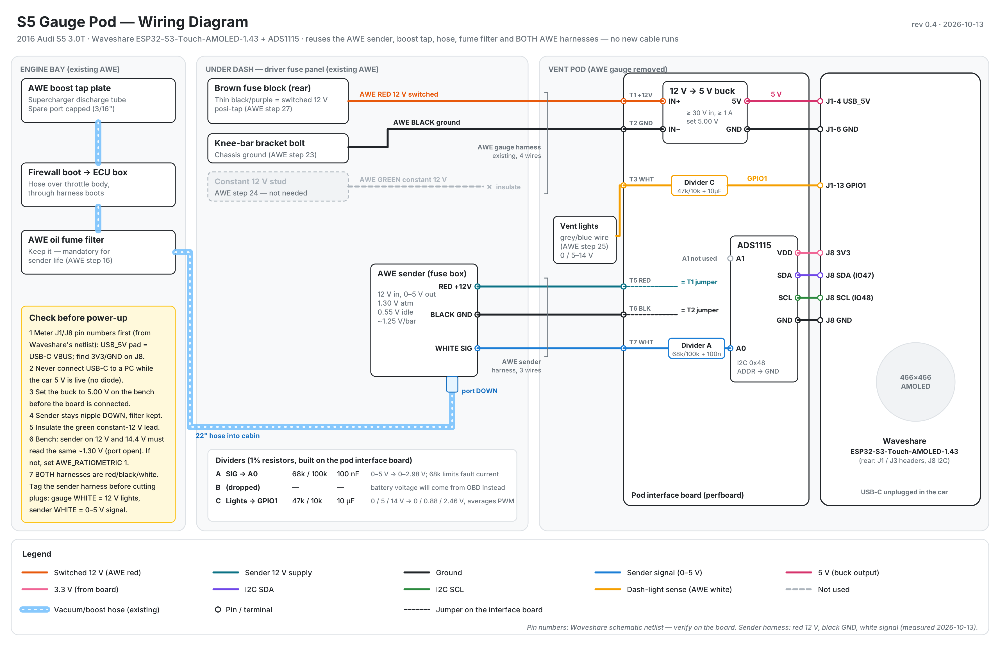
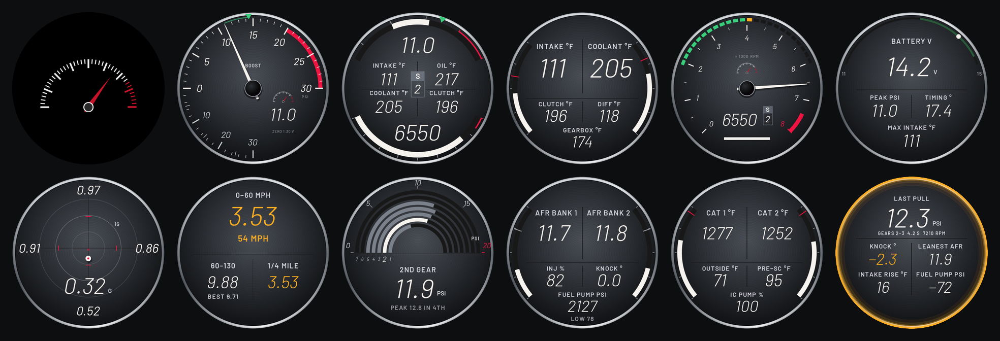

# S5 Gauge Pod: engineering notes

The full build and design record. The project's front page, with pictures and the short version, is [README.md](README.md).

A round digital boost gauge for the driver's vent of my 2016 Audi S5 3.0T (supercharged). It replaces the dial of the old AWE Tuning vent boost gauge but keeps **everything else from the AWE kit**: the boost tap, hose, fume filter, the AWE sender, and both AWE harnesses. There are no new cable runs through the dash. Everything else comes over OBD through a Veepeak BLE dongle: engine, gearbox, sport differential and the car's clock.

| | |
|---|---|
| **Firmware** | Version 1.0 (2026-11-23). `FW_VERSION` in `config.h`; shown on the boot screen, in the serial log and on the web page's Firmware card. What changed: *Version history* at the end. |
| **Status** | In the car and driving since October 2026: sender, OBD, warnings, pull summaries, health trends, logging and the G-meter all running. |
| **Display / MCU** | Waveshare ESP32-S3-Touch-AMOLED-1.43 (466×466 round AMOLED, ESP32-S3R8, 16 MB flash, 8 MB PSRAM) |
| **Boost sensor** | Existing AWE sender: 12 V supply, 0–5 V output. MPX4250AP kept as a fallback in the firmware. |
| **ADC** | ADS1115, 16-bit, I2C |
| **Firmware** | Arduino (ESP32 core 3.x), GFX Library for Arduino, Adafruit ADS1X15 |
| **OBD** | Veepeak BLE (ELM327) over Bluetooth LE: engine (7E0), gearbox (7E1), sport differential (71D), steering (712) |
| **Car** | 2016 Audi S5 3.0T, B8.5, LHD |

```
audi-b8-oled-vent-pod/
├── README.md                    ← the project's front page
├── ENGINEERING.md               ← this document
├── WIRING.md                    ← point-to-point connection list and bench checks
├── IDENTIFIERS.md               ← every OBD identifier found on this car: scaling, status, what's still unconfirmed
├── docs/
│   ├── wiring-diagram.svg       ← source drawing (opens in any browser)
│   ├── wiring-diagram.png       ← same, as an image
│   ├── breadboard-layout.svg    ← interface board laid out on a full-size breadboard
│   ├── breadboard-layout.png
│   ├── images/                  ← pictures for the README (screens and web page, from the public build)
│   ├── art/pod-badge.png        ← the boot-screen badge (original artwork)
│   ├── screens.png              ← every screen, rendered by the firmware's drawing code
│   └── screen-mockup.html       ← interactive preview, runs the same drawing code (wasm)
├── firmware/
│   └── S5GaugePod_Test/         ← the sketch; every file is listed under 6. Firmware → Files
│       ├── S5GaugePod_Test.ino
│       ├── config.h             ← every pin, constant and threshold lives here
│       ├── gauge_render.h       ← all screen drawing (shared with the preview)
│       ├── gauge_fonts.h / gauge_badge.h ← Barlow fonts and the gauge badge (shipped)
│       ├── private/             ← your own fonts / badge, used instead when present (git ignores it)
│       └── …                    ← OBD, watcher, timers, health, logger, web UI
├── tools/
│   ├── web/index.html           ← the phone page (gen_web.py gzips it into web_page.h)
│   ├── gen_fonts.py             ← regenerates gauge_fonts.h (Barlow; or your own font into private/)
│   ├── gen_badge.py             ← regenerates gauge_badge.h from a PNG (docs/art/pod-badge.png)
│   ├── gen_web.py               ← regenerates web_page.h from web/index.html
│   ├── build_preview.sh         ← recompiles gauge_render.h to wasm into the preview
│   ├── *_test.cpp               ← desktop tests: obd, watch, perf, gear, imu, log, scan, health
│   ├── watch_replay.cpp         ← replays a drive log through the warnings and pull summaries
│   ├── poll_check.py            ← checks the OBD poll list against the freshness windows
│   ├── sender_fit.py            ← sender voltage against the ECU over drive logs: offset or slope?
│   ├── fakes/                   ← stand-ins for Arduino storage (log_test)
│   └── preview/                 ← wasm glue and a native test renderer
└── reference/                   ← local only, not in the repository (other people's documents and assets):
    ├── audi-type-2/             ← the car's own font, used for my car's build through private/
    ├── s-badge.png              ← the badge on my car's boot screen, same
    ├── AWE_B8_S4_S5_vent_boost_gauge_install.pdf   ← AWE Tuning's install guide (from AWE)
    └── waveshare-1.43-interface-definition.png     ← Waveshare's pin diagram (from their wiki)
```

---

## 1. How it works



**Pressure path (unchanged).** The AWE tap plate on the supercharger discharge tube feeds a hose that runs over the throttle body, through the firewall boot into the ECU box, and through AWE's oil fume filter. A 22″ hose then goes into the cabin to the AWE sender, which stays zip-tied to the fuse box with its nipple pointing down.

**Wiring (unchanged up to the vent).** Both AWE harnesses already run from the fuse panel area up to the vent:

| Harness | Wire | Function | Where it lands in the pod |
|---|---|---|---|
| Gauge harness (4 wires) | Red | Switched 12 V (black/purple wire on the fuse block, AWE step 27) | T1, then to the buck and the sender supply |
| | Black | Ground (knee-bar bolt, AWE step 23) | T2 |
| | White | Dash lighting (grey/blue vent lighting wire, AWE step 25) | T3, then Divider C to GPIO1 |
| | Green | Constant 12 V | Not used; insulate it |
| Sender harness (3 wires) | Red | Sender 12 V (the old gauge supplied this) | T5, jumpered to T1 |
| | Black | Sender ground | T6, jumpered to T2 |
| | White | 0–5 V pressure signal | T7, then Divider A to ADS1115 A0 |

> **Both harnesses use red, black and white.** Tag the sender harness before cutting either plug off. The two whites are the easiest to swap and they're very different: the gauge harness white is the 12 V dash-light feed, and the sender harness white is the 0–5 V signal. 12 V on the signal input is survivable (Divider A limits it), but the gauge would read nonsense.

**In the pod.** The AWE gauge comes out. A small perfboard (the *pod interface board*) takes the two harness plugs: cut them off, or salvage the mating sockets from the old gauge. It carries:
- a 12 V → 5 V buck converter feeding the Waveshare board through its USB_5V header pad, so no USB-C cable sticks out of the vent;
- the ADS1115, on the board's I2C connector;
- two voltage dividers: Divider A for the sender signal to A0, and Divider C for the dash-light wire to GPIO1. (Divider B, a 12 V monitor on A1, was dropped to save space; battery voltage will come from OBD. `SUPPLY_SENSE_ENABLED` in `config.h` brings it back if ever needed.)

### Why these parts

- **Keeping the AWE sender.** It's already plumbed and wired. Its output (0–5 V, about 1.25 V/bar) spans roughly −1 to +3 bar, so it reads vacuum and covers far more boost than this car makes. The firmware zeroes it at every key-on, so only its slope needs calibrating.
- **External ADS1115.** The ESP32's built-in ADC is noisy and non-linear enough to show up as needle jitter, worst in the bottom few hundred millivolts where idle vacuum sits. The ADS1115 resolves about 0.2 mV.
- **Divider A (68k/100k).** It scales the 0–5 V signal to 0–2.98 V, below the ADS1115's 3.3 V supply. If the signal ever shorts to 12 V, the 68 kΩ limits the fault current to about 0.12 mA.
- **No 12 V monitor.** Battery voltage comes from OBD in Phase 3. If the bench check shows the sender's output following its supply (unlikely), the correction can use the OBD voltage, which changes slowly enough, or Divider B can be added back on A1 (47k/10k + 1 µF, `SUPPLY_SENSE_ENABLED 1`).
- **MPX4250AP fallback.** If the sender ever fails or proves unusable, `SENSOR_TYPE SENSOR_MPX4250` switches the firmware back to the NXP sensor (5 V ratiometric, datasheet curve). That version needs a 5 V supply at the sensor and a Divider B (68k/100k) on A1, since that sensor is ratiometric.

---

## 2. Measurements so far

Taken 2026-10-13 at the AWE sender and the vent lighting wire, with a multimeter (DC volts) referenced to chassis ground.

| What | Condition | Reading |
|---|---|---|
| Sender wire colours | — | Red = 12 V, black = ground, white = signal |
| Sender supply | Key on | 12 V (supplied by the AWE gauge) |
| Sender signal | Key on, engine off (atmosphere) | **1.30 V** |
| Sender signal | Idle (AWE gauge has no vacuum scale; needle at 0) | **0.55 V** |
| Dash-light wire (AWE white / grey-blue) | Headlights off | **0 V** |
| | Headlights on, dimmer fully down | **5 V** |
| | Headlights on, dimmer fully up | **14 V** |
| | Earlier reading, dimmer mid | 6.5 V |

**What they mean:**
- **Sender:** the best fit is a −1 to +3 bar sender on 0–5 V, which gives 1.25 V/bar (0.0862 V/psi). Measured from the 1.30 V zero, that puts idle at about 17.7 inHg, inside the 17–22 inHg AWE's install guide expects. The more common 0.5–4.5 V scaling would imply about 28 inHg at idle, which is unrealistic. This is a fit to one point, not a confirmed spec; the slope still needs calibrating (section 7).
- **Dash light:** the wire is PWM-dimmed. The meter averages it, and so does Divider C's 10 µF cap, so the firmware sees a steady voltage that tracks the dimmer knob.

**Still to do:**
- [ ] **Supply-drift check (bench).** With the port open to air, power the sender at 12 V and then 14.4 V. The engine-off reading was taken at about 12.4 V battery voltage, but the car runs at about 14 V. If the signal stays at about 1.30 V, the sender regulates internally: leave `AWE_RATIOMETRIC 0` (the default, and the likely outcome). If it rises roughly in proportion to the supply, set `AWE_RATIOMETRIC 1`.
- [ ] **Slope calibration** (section 7).

---

## 3. Bill of materials

| Qty | Part | Notes |
|---|---|---|
| 1 | Waveshare ESP32-S3-Touch-AMOLED-1.43 | The plain board, not the cased "-B" version. Comes with two SH1.0 4-pin cables. |
| 1 | ADS1115 breakout | Adafruit #1085 or equivalent. Address 0x48 (ADDR → GND). |
| 1 | 12 V → 5 V buck module | **Pololu D45V5F5** (#5433): 5 V 500 mA, 5.2–65 V in, 7.6 × 11.4 × 2.8 mm, three pins (VIN, GND, VOUT) on 0.1″. Alternatives: D36V6F5 (600 mA, 50 V in, 13 × 10 mm) or D24V10F5 (1 A, 36 V in, 18 × 13 mm) if the pod draws more than about 350 mA. None has reverse-polarity protection: put a 1N5819 / SS14 Schottky in series with the 12 V input. |
| 1 | 22–33 µF electrolytic, ≥ 25 V (optional) | Across the buck's VIN–GND, right at its pins: Pololu's suggestion against switch-on spikes from long leads |
| 1 | 1N5819 or SS14 Schottky diode | Reverse-polarity protection for the buck input |
| 1 | 68 kΩ 1% resistor | Divider A, top |
| 1 | 100 kΩ 1% resistor | Divider A, bottom |
| 1 | 47 kΩ 1% resistor | Divider C, top |
| 1 | 10 kΩ 1% resistor | Divider C, bottom |
| 1 | 100 nF ceramic | At ADS1115 A0 |
| 1 | 10 µF ceramic, ≥ 10 V | At GPIO1 (averages the PWM dash-light feed) |
| 1 | 3.3 V zener (e.g. BZX84C3V3), optional | Clamp on GPIO1 |
| — | Perfboard, screw terminals or a 7-way header, heat shrink, 1.27 mm-pitch wire or header | Pod interface board |
| 1 | 3D-printed vent insert | Holds the board and interface board in the vent housing, like the AWE pod. To be designed. |
| 1 | BLE OBD dongle | Veepeak OBDCheck BLE (in use). Must be BLE, not Bluetooth Classic. |
| — | *(Optional, calibration)* Hand vacuum pump with gauge | Mityvac-style. Gives a clean slope calibration at 10 and 20 inHg. |
| — | *(Fallback only)* NXP MPX4250AP + 1 µF / 100 nF / 470 pF + a second 68k/100k pair | Only if the AWE sender is replaced |

Already in the car and reused: the AWE tap plate, hoses, fume filter, sender, both harnesses and the fuse-panel taps. Removed: the AWE gauge itself.

---

## 4. Board pin map

> **Confirmed against Waveshare's interface drawing** (`reference/waveshare-1.43-interface-definition.png`): the J1 and J3 header maps below match it pin for pin. Waveshare's drawing labels one J1 pin GPIO18, but the silkscreen and schematic say IO16, and GPIO18 is on J3. The order of the small J8 I2C connector is still unconfirmed, so either meter it or use the I2C pins on J3, which are labeled on the silkscreen.

### What this project uses

| Signal | Board connection | Notes |
|---|---|---|
| 5 V in (from the pod buck) | **J1 pin 4 (USB_5V)** | Same net as USB-C VBUS. It feeds a Schottky diode, then the 3.3 V buck (2.3–5.5 V input). **Never connect USB-C to a PC while the car 5 V is live.** |
| GND | **J1 pin 6** | |
| Light sense | **J1 pin 13 (GPIO1, ADC1_CH0)** | Through Divider C |
| ADS1115 VDD | J8 3V3 | |
| ADS1115 SDA | J8 SDA (GPIO47) | Shared bus with touch, IMU and RTC. The board already has 10 k pull-ups. |
| ADS1115 SCL | J8 SCL (GPIO48) | |
| ADS1115 GND | J8 GND | |

### Fixed on-board connections (set in `config.h`)

| Function | GPIO |
|---|---|
| AMOLED QSPI CS / CLK / D0 / D1 / D2 / D3 | 9 / 10 / 11 / 12 / 13 / 14 |
| AMOLED reset | 21 |
| AMOLED_EN (R9 not fitted on most boards) | 42 |
| I2C SDA / SCL | 47 / 48 |
| Touch FT3168 | I2C 0x38 |
| IMU QMI8658 | I2C 0x6B |
| RTC PCF85063 | I2C 0x51 |
| Battery ADC | 4 |
| SD card | 38–41 |

### Full header map (from netlist)

| Pin | J1 | J3 |
|---|---|---|
| 1 | USB D+ (IO20) | 3V3 |
| 2 | VBAT | IO18 |
| 3 | USB D− (IO19) | SCL (IO48) |
| 4 | **USB_5V** | IO38 (SD) |
| 5 | IO6 | SDA (IO47) |
| 6 | **GND** | IO39 (SD) |
| 7 | IO5 | GND |
| 8 | IO16 | IO40 (SD) |
| 9 | IO3 | RXD (IO44) |
| 10 | IO17 | IO41 (SD) |
| 11 | IO2 | TXD (IO43) |
| 12 | IO7 | IO46 (strapping) |
| 13 | **IO1** | 3V3 |
| 14 | IO0 (BOOT) | IO45 (strapping) |

**Alternative I2C hookup:** J3-5 SDA, J3-3 SCL, J3-1 or J3-13 3V3, J3-7 GND, all on the 1.27 mm header with silkscreen labels. **J8 (SH1.0 4-pin I2C, per netlist, unconfirmed):** 1 SCL, 2 SDA, 3 3V3, 4 GND. **J10 (SH1.0 4-pin UART):** 1 RXD, 2 TXD, 3 3V3, 4 GND.

**Free for later:** IO2, IO3, IO5, IO6, IO7, IO16, IO17 and IO18. That's enough for a wired CAN transceiver (TWAI) if BLE OBD turns out too slow. Avoid IO0, IO45 and IO46 (strapping pins), IO38–41 (SD card) and IO4 (battery ADC).

---

## 5. Analog front end

### Pressure (AWE sender)

The firmware works in psi relative to atmosphere:

```
Vsig = ADS A0 × 1.68                          (Divider A, 68k / 100k)
Vsig = Vsig × 12.4 / Vsupply                  (only if AWE_RATIOMETRIC = 1; needs a supply reading)
psi  = (Vsig − Vzero) / AWE_V_PER_PSI         (0.0862 V/psi until calibrated)
```

`Vzero` is captured at every key-on (engine off). The firmware averages 64 samples and accepts the result if it is steady and falls in the 1.15–1.45 V window, then saves it to flash. If the engine is already turning (cranking, remote start, quick restart), the reading is refused and the last saved zero is used instead; the status line shows `ZERO x.xx V (SAVED)`. Above about 3,500 ft the atmosphere itself reads under 1.15 V, so a refused key-on zero gets a second chance: once the ECU has reported the engine stopped for 3 s, a steady reading down to 0.95 V (`AWE_ZERO_WIDE_MIN_V`, about 8,000 ft) is taken as the zero, as long as it agrees with the ECU's barometer to within 0.06 V (`ZERO_BARO_TOL_V`, about 0.7 psi). The pod works out what the zero should be from the last zero taken in the usual window (each one is paired with the ECU's barometer a few seconds after OBD comes up, saved only when it has moved) and how far the barometer has fallen since. So a sender or wire that has started reading low is still refused, with a `[zero] ... from what the ECU's barometer predicts` line in the serial log. Without OBD or a learned pair, only the usual window is accepted. A manual re-zero uses the same wider window, with the same check, when the ECU says the engine is stopped. Because the zero is re-measured at every key-on, offset drift and altitude don't matter, only the slope does.

Expected values with the current 1.25 V/bar estimate:

| Condition | Gauge | Sender Vsig | ADS A0 pin |
|---|---|---|---|
| Hard decel / high vacuum | ~24 inHg | ~0.28 V | ~0.17 V |
| Idle (measured) | ~17.7 inHg | 0.55 V | 0.33 V |
| Key on, engine off (measured) | 0 | 1.30 V | 0.77 V |
| Stock full throttle | ~12 psi | ~2.33 V | ~1.39 V |
| Gauge full scale | 30 psi | ~3.89 V | ~2.31 V |
| Sender full scale (estimated) | ~43 psi | 5.0 V | 2.98 V |

The dial runs from 30 inHg to 30 psi and is laid out like the original AWE gauge (30 inHg at 6 o'clock, 0 at 9, 30 psi at 3), with red blocks from 20 psi (`GAUGE_RED_PSI`).

### Supply monitor (Divider B, not fitted)

Dropped to save space; battery voltage will come from OBD. With `SUPPLY_SENSE_ENABLED 0` (the default) the firmware never reads A1 and uses a nominal 12.4 V. If it's ever added back: 47k / 10k on A1 with 1 µF, ratio 5.7 (14.4 V gives 2.53 V at the pin).

### Dash-light sense (Divider C)

47k / 10k, ratio 5.7, with 10 µF across the 10k to average the PWM. Measured values map to:

| Lights | Wire | GPIO1 | Pod brightness |
|---|---|---|---|
| Headlights off | 0 V | 0 V | 225 (`BRIGHT_DAY`, daytime) |
| On, dimmer down | 5 V | 0.88 V | 25 (`BRIGHT_DIM_MIN`) |
| On, dimmer up | 14 V | 2.46 V | 175 (`BRIGHT_DIM_MAX`) |

Headlights count as on above 1.2 V and off below 0.7 V on the wire (`LIGHT_ON_V` / `LIGHT_OFF_V` in config.h, hysteresis). Between `DIM_MIN_V` and `DIM_MAX_V` (2.3–13.7 V, the dimmer fully down and fully up as measured in the car), brightness tracks the knob linearly. Switching on or off is instant: two raw readings in a row past the threshold (0.2 s) flip the night face and the brightness together, with no ramp. Only the dimmer wheel, with the lights already on, is smoothed so the brightness doesn't step.

---

## 6. Firmware

### Build setup

| Arduino IDE setting | Value |
|---|---|
| Board | ESP32S3 Dev Module (esp32 core **3.x**) |
| USB CDC On Boot | Enabled |
| Flash Size | 16MB |
| PSRAM | **OPI PSRAM** |
| Partition Scheme | 16M Flash (3MB APP/9.9MB FATFS) |

Libraries (Library Manager): **GFX Library for Arduino** (moononournation), **Adafruit ADS1X15** and **NimBLE-Arduino** (h2zero, 2.x). WebServer, FFat, Preferences and mDNS come with the ESP32 core. U8g2 is no longer needed. The partition scheme must be **16M Flash (3MB APP/9.9MB FATFS)**: the app is about 1.6 MB and the logs live in the 9.9 MB FATFS part.

Built with esp32 core 3.3.12, GFX Library 1.6.9 and Adafruit ADS1X15 2.6.2. The app is about 1.9 MB of the 3 MB slot (60 %). Version 1.0 compiles with no warnings at `--warnings all` (NimBLE-Arduino 2.5.2) and passes the desktop tests. The version number is `FW_VERSION` in `config.h`: raise it with every build that goes into the car and add a line to *Version history*.

### Files

| File | What it is |
|---|---|
| `S5GaugePod_Test.ino` | Setup, sensor task, touch, dimming, serial, and `renderFrame()`, which assembles each frame |
| `config.h` | Every setting: pins, sensor scaling, gauge range, red zone, shift point, timings |
| `gauge_render.h` | **All screen drawing.** Plain C++ with its own anti-aliased shapes, fonts and maths, writing RGB565 into the frame buffer |
| `gauge_fonts.h` | Audi Type glyphs, 4-bit anti-aliased, numerals slanted about 11° like the cluster, bold captions up to 26 px, a 66 px number size for secondary readouts and 40 px capitals for the pop-ups (generated by `tools/gen_fonts.py` from `reference/audi-type-2/`) |
| `settings.h` | Settings the web UI can change (calibration, red zone, shift, redline, brightness, logging, OBD, Wi-Fi). Defaults from `config.h`, saved in flash |
| `obd_ble.h` / `obd_parse.h` | Veepeak BLE (ELM327) client, the poll list (engine, gearbox, sport differential, steering), talking to other modules, the identifier finder and module sweep, and the reply parser, including multi-frame replies (parser unit-tested by `tools/obd_test.cpp`) |
| `logger.h` | CSV drive logs on the microSD card, or the FFat partition without one (tested by `tools/log_test.cpp` against fake storage in `tools/fakes/`) |
| `web_ui.h` / `web_page.h` | Wi-Fi access point and web server; the page is `tools/web/index.html`, gzipped by `tools/gen_web.py` |
| `imu.h` / `imu_cal.h` | QMI8658 motion sensor driver, and the G-meter maths: learning level and forward, car-frame g, peaks (tested by `tools/imu_test.cpp` with simulated drives) |
| `perf.h` | Performance timers: 0–60, 60–130 and ¼ mile from the G-meter and OBD speed (tested by `tools/perf_test.cpp` with a simulated S5) |
| `scan_logic.h` | The identifier finder's table and ranking (OBD tab → *Find an identifier*; tested by `tools/scan_test.cpp`) |
| `watch.h` / `pull_sum.h` | Warnings, pull summaries, usual-boost curve and belt slip (tested by `tools/watch_test.cpp`; `tools/watch_replay.cpp` runs a real drive log through it) |
| `tools/poll_check.py` | Reads the poll list and the freshness windows from `obd_ble.h`, simulates the scheduler at cruise and on boost, and fails if any reading's window is too tight for how often it really arrives, or if any code uses a fixed window instead of `ageFor()`. Run it after changing either. |
| `tools/sender_fit.py` | Fits the sender voltage against the ECU's manifold pressure over whole drive logs: the slope from vacuum readings (thousands of steady ones, and a check that the line goes through 0 V at 0 kPa), boost reported separately as how far the sender sits from that line, and whether the sender follows the battery voltage. `python3 tools/sender_fit.py --vpp 0.0862 log_0040.csv ...` |
| `gear.h` | Gear from RPM ÷ road speed, with learned ratios (tested by `tools/gear_test.cpp`, which can also replay a log) |
| `health.h` | One record per pull in `/ffat/health.bin` for the web page's Health tab (tested by `tools/health_test.cpp`) |
| `frame_pipe.h` | Double-buffered frames: draws the next frame while the last one is sent, and sends only the changed rectangles (checked against a simulated panel by `tools/preview/pipe_test.cpp`) |
| `gauge_badge.h` | The S badge at boot-splash and face sizes, RGB565 + alpha (generated by `tools/gen_badge.py` from `reference/s-badge.png`) |

### Screens and the browser preview



*Rendered by `gauge_render.h` itself, not a mock-up.*

`docs/screen-mockup.html` shows every screen side by side, live. It runs `gauge_render.h` compiled to WebAssembly, so what it shows is what the screen draws, pixel for pixel. The desktop and wasm builds were checked to produce identical frames, and the ESP32 build turns off fused multiply-add so its float maths follows the same order. Only the panel's own colour and brightness differ. Its "Firmware settings" sliders are the `config.h` values. After changing `gauge_render.h`, run `tools/build_preview.sh` to rebuild the preview. It needs clang with the wasm32 target.

| Page | Shows | Data |
|---|---|---|
| **Boot** | S badge fades in on black (any missing part listed in amber under it), then cuts straight to the gauge and the needle sweep | — |
| **Boost** | AWE layout: 30 inHg at 6 o'clock, 0 at 9, 30 psi at 3. S-gauge face, red blocks from `GAUGE_RED_PSI`, red peak telltale needle (falls back 8 s after a pull, see below); a green arrow outside the ticks at the boost the ECU is asking for, with a thin green arc from the needle up to it while boost falls short (see *ECU boost target*); S badge, the digital boost (one size up) and the gear chip in the empty bottom-right quarter. No inHg caption (the scale and the minus sign say it) | Analog (AWE sender) |
| **Overview** | Everything at a glance, sized to read from the seat: boost arc across the top with a big number, RPM arc across the bottom with a big centred RPM, and four temperatures between them in a 2 × 2 grid: intake, oil, coolant and the S tronic clutch oil, with °F in their titles. The large gear chip sits dead centre of the grid, its S / M tab on top. Battery, timing and throttle moved off this page; battery still pops up as a warning when it's out of range. While a warning banner is up, the boost number moves down out from under it (no badge) | Analog + OBD |
| **Temps** | Intake after the intercooler (left arc) and coolant (right arc) in the largest numerals; under them the drivetrain: **CLUTCH** (S tronic clutch oil, `7E1 221259`) and **DIFF** (sport differential oil, `71D 221307`) side by side, **GEARBOX** (`22125A`) centred below; amber / red at 250 / 275 °F for the clutch (from log_0038: about 200 cruising, never above 226 in hard driving, +30–38 per standing launch, so amber means launches have stacked up), 230 / 255 for the gearbox and 250 / 275 for the diff (first guesses). Units are in the titles (INTAKE °F, CLUTCH °F). Max intake is on the System page and the pull summary (no badge) | OBD |
| **Engine** | Tach 0–8000, red zone from `REDLINE_RPM` (7400 for the tune), shift ring that fills over the 1500 rpm below `SHIFT_RPM` (7200) and flashes there, red peak telltale needle at the highest RPM of the pull (falls back 8 s after it), RPM and a pedal bar | OBD |
| **System** | One big readout with its own arc plus three below (two side by side, one centred): battery, peak boost, timing, max intake. Units are in the labels (BATTERY V, PEAK PSI) so the small ones can be big numbers. Tap a small one to make it the big one (saved to flash). Warnings take the top slot on their own: battery out of range or intake at 140 °F+ while it lasts, a new red-zone peak for 10 s (no badge) | OBD + session |
| **G-force** | Friction circle with the dot, peaks per direction in larger numbers at the ends of the axes (braking at the top, accelerating at the bottom, no words), the combined g big at the bottom | QMI8658 |
| **Perf** | 0–60 big at the top, 60–130 and ¼ mile (with trap speed) below. At a stop with the timer armed, **launch readiness**: one big word and an edge ring, **READY** (green) or **WAIT** (amber), with the first thing in the way under it: OIL COLD (under 170 °F), CLUTCH 246 °F ~30 S (clutch oil `1259` above 230 °F, with a cool-down estimate at the 0.6 °F a second it cools after a launch), SELECT S OR M, PARKING BRAKE ON. Under READY: HEAT SOAK in amber when the intake is at 135 °F or more (costs power, not a reason to wait), else the best 0–60. **STAGED** with the held RPM while you're on the brake with the revs up. The ring goes as the run starts, and the blue warm-up ring isn't drawn on this page (OIL COLD says it). Limits from logs 33–38: the clutch peaks at 216–226 °F in hard driving and a launch adds 30–38; the intake sits at 113–126 °F at a typical stop. Clocks run in amber; the best since power-on under each. Hold 1 s to reset those bests. "OBD SPEED ONLY" when the G-meter isn't calibrated yet | G-meter + OBD speed |
| **Gears** | Peak boost in each gear (pedal 70 %+) as seven rings over the top half, 1st inside to 7th outside, on a 0–20 psi scale with the psi marked on the ticks; a ring closes at the red zone and turns red there. The current gear's ring is white and its peak is the big number below, with the highest of all under it (PEAK 16.4 IN 4TH). Reset with the peak | Analog + calculated gear |
| **Fuel** | Air-fuel ratio per bank on two arcs with a stoichiometric tick and the ECU's target, in large numbers; under them the same layout as Temps: **INJ %** and **KNOCK °** side by side (the knock title becomes KNOCK ° CYL 2 in the warning colour when a cylinder retards), **FUEL PUMP PSI** centred below with the low side (LOW 78) centred under it | OBD |
| **Heat** | Catalyst temperature per bank on two arcs (amber from 1800 °F, red from 1850 °F) in large numbers (CAT 1 °F, CAT 2 °F); under them the same layout as Temps: **OUTSIDE °F** and **PRE-SC °F** (intake before the supercharger) side by side, **IC PUMP %** centred below | OBD |
| **Pull** | The last full-throttle pull: peak boost (big), gears, time and RPM; then four results as big numbers with their units in the titles: KNOCK °, LEANEST AFR, INTAKE RISE °F and FUEL PUMP PSI (against target); and a glowing halo round the edge of the screen for the whole pull at a glance: green when everything was fine, amber or red by its worst reading (knock, leanest AFR, hottest cat, injectors, fuel pump, boost against usual: the hottest cat and injectors still count, they're on the web page). A short line only when the boost needs words: BOOST LOW −2.1, BELT SLIP?, or LEARNING 1 OF 3 | Analog + OBD |

**Personal use only:** Audi Type's own notice says it is "for exclusive use by AUDI AG and its affiliates", and the S badge is Audi's trademark. Both are fine in your own car. If this ever becomes a J3DMParts product, switch to `python3 tools/gen_fonts.py <barlow dir> … barlow` and drop the badge.

Until OBD is wired in, the OBD pages show `--` and "NO OBD YET". In demo mode every page is driven by the same 18 s drive cycle the preview plays.

### Web UI, OBD and logging

**Web UI.** The pod makes its own Wi-Fi network: **S5-GaugePod**, password **audis5pod**. Join it from the phone and open **http://192.168.4.1** (or http://s5pod.local). The phone has no internet while it's on this network. The page has six tabs:
- **Live:** the warning banner (same text as on the pod), boost arc and number, peak, the OBD values, a *Fuel and heat* grid (AFR per bank with target, fuel pump with target, low side, injectors, intercooler pump, both cats, intake before the supercharger with outside air, clutch oil, gearbox and diff oil), the *Last pull* card (the Pull page's numbers plus the usual-boost curve) and the earlier pulls, buttons for peak reset, page change and re-zero.
- **Runs:** the best 0–60, 60–130 and ¼ mile, and the last 30 runs with date, trap speed, peak boost, outside temperature and which drive log they're in. *Clear runs* starts over.
- **Health:** every pull compared with a baseline over weeks and miles: boost at the same RPM, boost against the ECU's target, fuel pressures, knock, AFR, intake heat, injector duty and belt slip, each Steady / Watch / Worse, with a chart (see *Health trends*).
- **Logs:** every saved drive with when it ended (the file's time stamp, from the pod's clock; Save names the download with the date, e.g. `log_0038_2026-10-23_1742.csv`), size, View (chart of boost and RPM with peak boost and max RPM), Save (CSV download) and Delete.
- **Settings:** everything in `settings.h`, saved to flash, including *Jump to a warning* and *Show the pull summary* (both on by default). Red zone, shift point and redline redraw the faces right away (the screen pauses for about 2 s). Wi-Fi changes apply after a restart. The **boost calibration** card compares the sender voltage at idle with the car's own manifold pressure and barometer over OBD and suggests the volts-per-psi value; "Use this value", then "Save settings".
- **OBD:** adapter state, replies per second, how often each reading actually arrives (asked vs got, at cruise and on boost), the PIDs the car supports, and a console that sends any ELM327 command (ATRV, 0100, Mode 22 such as 221001) and shows the reply. While the car is moving it only sends read requests (01, 02, 03, 06, 07, 09, 0A, 19, 22, 3E and ATRV / ATI / ATDP); clearing codes, resets, writes, actuator tests and adapter settings wait until it's stopped, and so do *Find modules* and *Find an identifier* (they pause every reading and warning). Commands go to the engine; prefix an address to ask another module, e.g. `7E1:221035 22126A` for the gearbox or `710:22F190` for the gateway (the pod sets where the adapter sends and listens, then goes back to the engine). The tab also shows three **gearbox temperatures** (`221259` / `125A` / `125B` from 7E1, A − 40 °C, about 100 °C after a drive; still to be confirmed on a cold start, where they should read near the outside temperature) the **odometer** (`22121C` on the engine, 4 bytes in km: 118,636 km matched the dash's 73,700 mi), the two **sport differential temperatures** (still to confirm), the **drive select** setting, the **gearbox program** (D / S / Manual) and the **car's clock** with the time zone the pod learned. Below that: **Find modules** (which modules answer on this car) and **Find an identifier** (see *Finding an unpublished identifier*).

**OBD.** (Every identifier, with its scaling and status: [IDENTIFIERS.md](IDENTIFIERS.md).) A background task finds the Veepeak by name (remembered by address after the first connection), sets up the ELM327 for the S5's CAN bus (ATSP6) and polls:
- RPM and speed together on every cycle (`010C0D`). The throttle plate (`0111`) isn't read on its own any more: on the 3.0T it says little (see *Throttle vs pedal*), so the Engine page's bar shows the pedal and the log's `throttle_pct` column is empty (it still comes with RPM, `010C11`, on a car where speed can't)
- coolant `0105`, intake after the intercooler `0177` (falls back to `010F` if the car doesn't support it), oil `015C` (not on the S5) or the Audi identifier `2220A1` (A − 40 °C, shown from cold, unlike the cluster), timing `010E`, battery `ATRV`, manifold pressure `0170` (this car has no `010B`, which is still used on cars that have it), the ECU's boost target `222029` ((A·256+B) × 0.0829 hPa), barometer `0133` and speed `010D`, each on its own interval
- wideband AFR for both banks plus the commanded ratio in one request (`01343844`, λ × 14.7; every 0.3 s on boost, 1 s otherwise), and outside air with both catalyst temperatures (`01463C3D`, every 3 s)
- Audi identifiers three to a request (that's all one CAN frame holds): pedal / bypass / boost target (`221070`, `222982`, `222029`); high-pressure fuel pump actual and target and the low-pressure pump (`22130E`, `22130F`, `221321`, (A·256+B) × 2.6534 hPa); injector pulse width (`2213A5`, × 0.004 ms, turned into duty with RPM); oil, intake before the supercharger and intercooler pump (`2220A1`, `221003` A·0.75 − 48 °C, `2211D6` × 0.0015 %); knock per cylinder in two groups of three. A group the ECU won't take falls back to one identifier at a time. The first two raw replies of each group go in the adapter log (OBD tab), and any value that comes back out of range is logged and dropped, so a wrong formula shows up there instead of on the gauge.

**These new identifiers are from the Audizine list and not yet confirmed on this car.** Check the OBD tab's adapter log after the first drive.

The BLE side follows the S2000 sketch, which is known to work with this Veepeak. It pairs if the adapter asks for it, uses a short connection interval and puts up with a slow reply during setup. The S5 version adds two things for CAN: requests go to the engine ECU only (`ATSH7E0`), so the gearbox doesn't answer as well, and each request whose answer fits in one CAN frame (Mode 01, and the short Mode 22 ones such as D / S / M, drive select, brake, parking brake, injector and odometer) carries the `1` suffix so the adapter replies as soon as the ECU answers instead of waiting out its timeout. Answers longer than one frame (AFR, knock, fuel, the cat temps, the gearbox temps...) carry the number of frames instead (the first frame holds 6 bytes, each after it 7), so those return as soon as the last frame arrives too. Clones don't all count frames the same way, so that one is checked twice over: an answer that comes back short is asked again without it (three of those and it's off), and every 20th long request goes without it so the OBD tab can show the average reply time with and without (if it's no faster, it's off). All of these fall back to the slower behaviour on their own if the car doesn't like them (Mode 22 separately: if an answer only comes without the suffix three times, it's off for Mode 22).

**Sharing the adapter.** It answers one request at a time, about 17 a second on this car: half go to RPM and speed, the rest to whichever other reading is most overdue as a share of its own period, so each reading gets its share of the time in proportion to how often it's wanted. That's less than the list asks for, so the boost schedule is weighted for the pull: AFR (every 0.4 s asked), knock (0.55 s), the boost target (0.45 s, a request of its own), pedal (0.8 s) and fuel pressure (1 s) first, timing, manifold pressure, injector, intake and the cat temps slower (2–4 s). The pod goes onto it from the analog sender the moment boost passes 1 psi, not a second later from OBD. A reading the car refuses three times in a row is set aside, but not for the whole drive: the engine's own readings get another go every 60 s, those from the gearbox, sport diff and parking brake every 30 s (drive select stopped after a minute or two in logs 25–38 and never came back), never during a pull. Failed replies from the other modules go to the adapter log, and "not answered" is logged once per run of misses. The sport diff and parking brake are asked without the quick-reply suffix (they answer through the gateway). At cruise the slow-changing or log-only readings are asked less often (coolant 4 s, battery 10 s, barometer 30 s, timing and manifold pressure 1.5 s, injector 4 s, oil / pre-SC / IC pump 5 s, rear O2 3 s, boost target 2 s since its arrow only shows on boost), so the rest get close to what they ask for (AFR and pedal about every 1.1 s instead of 1.75 s, fuel pressure 2.2 s instead of 3.4 s, knock 3.3 s instead of 5 s). A visit to the gearbox for D / S / M also reads its temperatures when they're at least half due, so the two share one switch there and back. Manifold pressure goes to every 120 ms the moment the sender can't be used (not only once a fresh OBD reading has taken over), and the idle trim's time constant no longer depends on how often it arrives. Every reading has a freshness window, about 2.5 times the slowest it arrives at cruise or on boost (`AGE_*` / `ageFor()` in `obd_ble.h`; the pages, warnings, web page and logs all use the same ones), so a value holds between readings instead of flickering to `--`, and readings that wait during pulls hold for 25 s. The sport diff and parking brake get a second try straight away when the first request after switching to them fails (the first one often does). Readings nothing uses during a pull wait until it's over (battery, coolant, barometer, rear O2, throttle plate, brake pedal, gearbox, sport diff, parking brake, odometer, car clock, catalyst tests; never more than 20 s), and the brake pedal and parking brake are only read below about 5 mph, since they're only for launch detection. The OBD tab's *How often each reading arrives* table shows, for every reading, how often it's asked for and how often an answer actually came, at cruise and on boost; the drive log's `obd_rate` column has the answers per second. Picking the adapter: the first time, it takes the strongest adapter-named device that's closer than `OBD_MIN_RSSI` (-80 dBm; in the car the adapter is about -50 to -70). It only remembers an adapter once a car has answered through it. One whose car never answers is let go after 2 minutes and ignored until the next restart, so the pod won't hold on to the S2000's Veepeak in the garage (these adapters take one connection at a time, so that would lock the S2000 out). Every minute, while it's searching, the serial log lists the adapter-like devices it can see with their signal strength. The OBD tab shows the last 40 adapter commands and replies, and the important events also print as `[obd]` lines on the serial monitor.

The Temps, Engine, System and Overview pages use these as soon as they arrive. Until then, the status line shows what the link is doing (OBD SEARCHING, OBD CONNECTING, OBD NO REPLY FROM CAR...). Every reading on the pages is shown only while it's fresh (the same windows as the warnings and the logs): one the car doesn't support, or that has stopped arriving, shows `--` instead of 0 or its last value.

**Logging.** One CSV per drive (`log_0001.csv`, ...) at 10 samples a second while the engine runs, closed 15 s after it stops. Columns: `ms, psi, peak_psi, vsig_V, rpm, throttle_pct, intake_F, coolant_F, oil_F, battery_V, timing_deg, map_kPa, baro_kPa, speed_kmh, page, lat_g, lon_g, map_target_kPa, knock_deg, knock_cyl, gear, pedal_pct, bypass_deg, hpfp_psi, hpfp_target_psi, lpfp_psi, afr_bank1, afr_bank2, afr_target, cat1_F, cat2_F, ambient_F, precharger_F, ic_pump_pct, injector_duty_pct, boost_source, trans, drive_mode, gbx_1259_F, gbx_125A_F, gbx_125B_F, diff_1306_F, diff_1307_F, o2_b1s2_V, o2_b2s2_V, brake` (empty when OBD has no fresh value; `boost_source` is sender, obd or demo; `trans` is the gearbox program D, S or M; `drive_mode` is empty (drive select isn't read any more; older logs have comfort, auto or dynamic); then the gearbox and sport differential temperatures, the two rear O2 sensors after the cats, and the brake pedal (1 pressed, 0 released), `obd_rate` (OBD answers per second), `gbx_1035`, `gbx_1026` (the gearbox's raw sport flag and shift program)). About 4 MB an hour; the oldest files are deleted when less than 1.5 MB is free. "Stop this log" saves and closes it; the next one starts at the next engine start.

**Where logs go.** To a microSD card in the board's slot if there is one (FAT32, any size; 1-bit SDMMC on IO41 CLK, IO39 CMD, IO40 D0), otherwise to the 9.9 MB FFat partition in the ESP32's own flash. The card is looked for at boot and again at each new drive; if it fails mid-drive, the log carries on in the internal flash. Drive numbers run across both, so names never repeat. The Logs tab lists both (marked SD / flash when there are some of each) and shows the one being recorded.

**Why the SD card is better.** While the internal flash is written, the ESP32 stops both cores from reading memory, so the display freezes for that moment. The first version saved after every line, which froze the pod most of the time with the engine running (lag, then a watchdog reset). In the internal flash the log is now written in whole 4 KB sectors (one short hitch about every 4 s while cruising), never while boosting or above 35 % throttle (the 64 KB buffer holds about a minute), and saved every minute, or every 4 s while the car stands still (every 2 s on the SD card): the pod loses power with the ignition, so a drive now loses its last few seconds, not up to a minute. Free space is checked every 30 s during the drive as well as at its start (the start-of-drive clean-up only makes 1.5 MB of room, about 20 minutes, so longer drives used to fill the internal flash and stop logging). The internal flash is only ever formatted before its first use: if it fails to mount later, it's left as it is (the health history is in it) and the Logs tab offers *Format internal storage*. The SD card is a separate chip, so writing it freezes nothing: it's written as data arrives and saved every 10 s. Either way the file is saved as soon as the engine stops, in case the pod loses power with the ignition.

**The "no logs" bug.** The log list was built by opening every file, and opening the one being written fails, which ended the list early: the recording drive (and everything after it) never showed. Listings now read names only, and also check the recent log numbers by name, since on this board even reading the folder came back empty in the older builds (which is also why the second build started again at `log_0001` and wrote over the first one). A new log never takes a name that already exists. Without OBD, a log only starts on a believable idle vacuum (-3 to -13.5 psi), so a sender reading 0 V at power-up no longer makes 15 s junk logs. `tools/log_test.cpp` checks all of this on simulated drives, including a missing, added and failing SD card. The Logs tab shows the slowest internal-flash write; the Live tab and the serial line (`gap=`) show the longest pause of the UI each second.

### Warnings and the pull summary

`watch.h` watches every reading, whatever page is up. When one crosses its limit for long enough, the pod jumps to the page that shows it and the warning **pops up as a big round disc in the middle** (red or amber, the page dimmed behind it, a ring pulsing out of it): what it is (in 40 px capitals), the number, and only a note that adds information: the cylinder, the bank, or the target. No advice text ("EASE OFF") and no "tap to dismiss" (tapping still dismisses it). After 6 s (`ALERT_POP_MS`) it shrinks to a banner across the top so the page underneath can be read, and it pops up again if it gets worse (amber to red). When it clears, the pod goes back to the page you were on (unless you changed page in the meantime). A tap dismisses that warning until it gets worse (amber to red) or clears and comes back. Turn it off with *Jump to a warning* in Settings. If several are up at once, red wins, then the newest.

| Warning | Limit | Page |
|---|---|---|
| Coolant | 230 °F (red) | Temps |
| Boost | at the red zone (`redPsi`), red | Boost |
| Oil | 260 °F amber, 280 °F red | Overview |
| Intake after the intercooler | 150 °F, only when moving above 15 km/h and running for a minute (heat soak at a stop is normal) | Temps |
| Battery | below 12.0 V or above 15.2 V, after 90 s running | System |
| Knock | New retard under real load (more than 8 psi, or the pedal at 80 % or more) with a steady foot (the pedal past 40 % for a second, at 60 % or more), and not lifting off (the pedal under 40 %, boost falling faster than 20 psi a second, or more than 4 psi under its highest of the last half second). Part-throttle tip-ins in the low gears read −3 to −5.6° on cylinder 6 again and again (logs 36–48), never with the foot held down, and a lift reads knock as boost falls away; neither counts: −3° on any cylinder amber, −4.5° red, at once. The ECU holds a cylinder's retard and eases it off slowly, so only retard that gets worse under load counts; a value carried over from part throttle doesn't (the S5 shows −5.6° on cylinder 6 in 1st-gear tip-ins at 0–5 psi, again and again: most likely the knock sensor hearing the driveline) | Fuel |
| Lean | AFR 1.0 or more leaner than the ECU commands, after 1 s on boost (above 3 psi) with the pedal at 50 %+, red. Readings of 20+ (29.4 is the wideband in a fuel cut) don't count: at light boost the 3.0T runs 14.7 on purpose, and the AFR is polled about once a second, so the first reading after a tip-in is from before it | Fuel |
| High-pressure fuel pump | below 85 % of its target on two separate readings, on boost with the target at 1,200 psi or more, red (one reading as the target jumps at a downshift tip-in isn't a fault: log_0036 read 1261 of 1494, then 1623 of 1631) (at idle it lags its low target, which doesn't matter) | Fuel |
| Low-pressure fuel pump | below 40 psi on boost | Fuel |
| Injector duty | 90 % | Fuel |
| Catalyst | 1800 °F amber, 1850 °F red, for 5 s (the ECU's modelled temperature; hard pulls on this car reach about 1750 °F, which is normal) | Heat |
| Belt slip | boost falling while RPM rises in the same gear (red) | Pull |
| Underboost | 1.5 psi or more below this car's usual boost at the same RPM (amber) | Pull |

The lean, catalyst and fuel pump limits were recalibrated on two drives (`log_0007`, `log_0008`): the first versions raised about 25 false warnings across them, the current ones none, while still catching the real cases in `tools/watch_test.cpp`. `tools/watch_replay.cpp` replays any log through the watcher and prints the warnings and pull summaries it would have shown: `./watch_replay log_0008.csv`.

AFR readings taken during a gear change don't count for the lean warning or the pull summary (the ECU cuts fuel for a full-throttle shift: one 1→2 shift read 17.2 AFR on bank 1, the next reading 11.9). The low-side fuel warning needs two separate low readings in a row on boost at 80 % pedal or more, or a low reading while the high-pressure pump is short of its target. At part throttle the ECU runs the low side on demand and it can lag a roll-on for a few seconds (log_0038: 29–36 psi at 35–62 % pedal for 3 s with the high side on target, then 94 psi); at full pedal it never went under 55 psi. The lean warning likewise needs two separate readings over target (one reading as the ECU drops its target at the start of boost isn't a lean). Fuel pressure and AFR samples taken during a gear change (RPM falling fast, and 0.5 s after; judged by when the reading was taken, since a fuel reading from mid-shift is still held a second later: log_0048 showed −241 psi from a 2→3 shift) are left out of the pull summary: the high-pressure pump's target jumps at a shift and the reading lags it (one 2→3 shift showed −350 psi for a moment). Each limit has to hold for a short time before it shows (instant for knock), and clear for a few seconds before the banner goes, so a single odd reading doesn't flash it.

**Pulls.** A pull starts at 80 % pedal or more with the sender above 2 psi and ends 0.4 s after the pedal drops below 50 %. It counts if it lasted 1.5 s and peaked at 5 psi or more. The lift-off isn't included. Each one fills the Pull page and the *Last pull* card, the last 10 are listed on the web page, and a `[pull]` line goes to the serial log. With *Show the pull summary* on, the pod shows the Pull page for 8 s after each pull, then goes back.

**Usual boost and belt slip.** The ECU asks for about 17.8 psi that this pulley can't reach at high RPM, so comparing against the target would flag every pull. Instead the pod learns this car's own boost at full pedal (85 %+, 2nd gear and up) in 500 rpm steps from 2,500 to 7,500 rpm, saved to flash. Once a step has 3 pulls, each new pull is compared with it: 1.5 psi or more below usual is flagged as underboost. A pull that looks wrong is learned from only slowly, so one bad day doesn't become the new normal. Belt slip is boost dropping 1.5 psi below its best in that gear while RPM keeps rising by 400 or more: a supercharger belt that slips loses boost as the revs climb. `tools/watch_test.cpp` checks the warnings, pull detection, learning and slip on simulated drives.

### ECU boost target

The green arrow on the Boost dial (and on Overview's boost arc) is the boost the ECU is asking for: its requested manifold pressure (`222029`, asked on its own; on this car `0170` doesn't carry one) minus the barometer. It arrives over OBD about twice a second on boost, and the arrow glides briefly to each new reading, so it's up to half a second or so behind the needle (which is the analog sender). When you lift off, the sender dropping through 0.5 psi hides the arrow straight away, until a target reading from after the lift arrives: otherwise the last one (still 17 psi) hung on for most of a second over a needle already in vacuum. While the needle is below it, a thin green arc runs from the needle up to the arrow: that's the shortfall. It's the tune's request, not a prediction: at full throttle this car asks for about 17.8 psi, which the smaller pulley can't make at high RPM, so a gap of 2–4 psi late in a pull is normal; at part throttle the needle should sit on it. Shown only while the ECU asks for more than 1 psi of boost (hidden again below 0.5). (Option C of the early mock-ups.)

### Boost from OBD when there's no sender

If the AWE sender isn't giving a reading (unplugged, a broken wire, out of range for 0.2 s) or there's no ADS1115 at all, the boost needle runs on the ECU's own manifold pressure over OBD instead (`0170`, minus the barometer). Manifold pressure is then asked for as often as the other readings allow (about 5 times a second), and the needle is smoothed a little more so it glides between readings. The Boost and Overview pages say **SENDER FAULT: BOOST FROM OBD** (amber) or **BOOST FROM OBD** (no ADS1115), and so does the web page. Peak, pulls, warnings, the timers' peak boost and the logs all use it; the log's `boost_source` column says `sender`, `obd` or `demo`. When the sender reads properly again, it takes over straight away. Demo mode now only starts with no ADS1115 **and** no OBD (on the bench), or from the serial `d`.

### Peak telltales

The red telltale on the Boost and Engine dials (and the peak tick on Overview's boost arc) follows the needle up and stays at the peak while you're still in the pull (within 2 psi / 400 rpm of it). Once the needle has dropped away for 8 s (*Telltale falls back after* in Settings, `PEAK_HOLD_S`), it sweeps back down to the needle and disappears, ready for the next pull. 0 keeps it until you reset it. Holding 1 s still resets everything, and the System page's PEAK BOOST and MAX RPM keep the whole drive.

### Finding an unpublished identifier (drive select mode)

The full list of what's been found, confirmed or not, with scalings, is in **[IDENTIFIERS.md](IDENTIFIERS.md)**.

The OBD tab's **Find an identifier** asks one ECU (engine 7E0 or gearbox 7E1) for every Mode 22 identifier in a range, keeps the ones it answers, and re-reads those after you change something in the car. Reading identifiers is read-only. Normal polling pauses while it runs.

1. Parked, ignition on. Set drive select to Comfort, label it *Comfort*, **Scan the range** (1000–2FFF: about 5–7 minutes; the status line shows how many answered and the time left).
2. Switch to Dynamic, label *Dynamic*, **Read again** (under a minute: only the ones that answered).
3. Comfort again, **Read again**; Dynamic again, **Read again**. Then Auto and Individual if you like (6 readings in all).
4. The list ranks identifiers that held steady within each label and differ between labels (green = proven steady, each state read twice). Sensors and counters drop out because they change between two readings of the same state. **Download CSV** has every answer from every reading.

If the engine ECU has nothing, try the gearbox (S versus D), or another range (0100–0FFF, 3000–4FFF). Once the identifier is found, it goes in the poll list and on a page like any other.

**Found so far (S5, 0B5 S tronic).** The engine (7E0, 1000–2FFF) has nothing that follows drive select. The gearbox (7E1) has the shift program, confirmed with the console in Comfort, Individual, Dynamic, Comfort + lever in S, and manual:

| | `221035` | `221026` |
|---|---|---|
| D | 00 | 07 |
| S (lever, or Dynamic, which puts the gearbox in S) | 01 | 06 |
| Manual | 01 | 07 |
| S with adaptive cruise on | 01 | another program (not yet seen raw) |

With adaptive cruise on in S, the gearbox runs another shift program: log_0036 has minutes of "M" at a steady 60–79 mph with the pedal at 0, upshifting into 7th on its own. So only `07` with the sport flag shows **M**; any other program with the sport flag shows **S**. The log's `gbx_1035` / `gbx_1026` columns carry the raw values, and each new `1026` value is written once to the OBD tab's adapter log, so the cruise program can be named.


The pod reads both once a second (header 7E1 for that one request, then back to 7E0) and puts a tab on the gear chip: **S** or **M** (nothing in D). On the Boost page it's on the chip's right; on the Overview and Engine pages it sits on top. The Live tab adds it after the gear, and the log has a `trans` column (D, S, M, empty = not known). Comfort and Individual (with the gearbox on Sport) both read as D, so the drive select mode itself isn't in the gearbox either; it's probably in the gateway (19, asked on 710 and answered on 77A), which the finder can't reach yet (the adapter only listens to 7E8–7EF unless told otherwise with ATCRA). **Drive select (found on the sport differential).** "Find modules" on this car lists 712 (RCevo, steering), 715 (airbag), 71C (SAS-GEN 2), 71D (4 Wheel Drive: the sport differential) and 752 (EPB-4, parking brake) besides the engine and gearbox; ABS, the gateway, the cluster and the MMI don't answer (most likely VW's older TP2.0). The sport differential changes with drive select and keeps its setting in `22170E` (also `22282A`): **01 Comfort, 02 Auto, 03 Dynamic**, checked with the console in each mode. Individual reads as whatever its sport differential setting is (03 on this car's). The pod used to ask for it every 3 s and pop the new mode up when it changed; that's taken out. Each read needed a switch to the diff and back (`ATSH71D`, `ATCRA787`, then back to the engine), about 7 % of the adapter's time at cruise, and the diff often misses the first request after the switch. It can still be asked from the console (`71D:22170E`); the log keeps an empty `drive_mode` column so older logs line up. Some answers start with `7F2278` ("busy, answer coming"); the real answer follows in the same reply. `221306` / `221307` (0x47 / 0x51) look like the differential's temperatures (A − 40 °C: 31 / 41 °C): asked every 10 s, one at a time, and shown on the OBD tab (with the raw byte) next to the gearbox temperatures, the drive select value, the gearbox program and the odometer, to be checked on a cold start.

**The car's clock (steering, 712).** `222BC1` is the odometer (4 bytes, km) followed by the car's date and local time: year, month, day, second, minute, hour (`1A 0A 14 37 14 12` = 2026-10-20 18:20:55). The pod reads it at the start of each drive (then every 10 minutes; a long answer, so with flow control). Whenever the pod's clock is right (from its RTC or the phone; checked at each car-clock reading and as soon as the phone sets the time), it learns the car's offset from UTC, rounded to 15 minutes and only if the car's clock is within 5 minutes, and saves it (`tzoff`); when the pod starts with no clock at all (no RTC time, no phone yet), it sets itself from the car with that offset, so runs and pulls get their dates. Daylight saving: once the car's clock is changed, the next phone visit re-learns the offset. The OBD tab shows the car's clock, the learned zone and what set the pod's clock.

**Brake pedal (engine).** `2216CE` and `2216CF` are the two brake switches (01 pressed, 00 released), found with the finder and checked in the console. Read once a second, logged (`brake` column) and shown on the OBD tab. Launch detection now needs the brake pressed when it's known: revs held up at a stop with the foot off the brake is neutral or Park, not a launch.

**Parking brake (752).** `222B78` on the electronic parking brake (answers on 7BC) is 0x33 released and 0x22 applied. The pod reads it every 3 s; launch detection ignores high, steady revs at a standstill while it's applied (revving parked isn't a launch), and the OBD tab shows it.

**Other modules.** The engine and gearbox answer on 7E8 / 7E9, which the adapter listens to by default. The other modules on this car (UDS, the VW way) answer on their address + 0x6A: gateway 710 / 77A, ABS 713 / 77D, instrument cluster 714 / 77E and so on. For those the pod sets `ATCRA` (listen address) and `ATFCSH` / `ATFCSD300000` / `ATFCSM1` (flow control for long answers) and puts them back afterwards (`ATCRA` with no address, `ATFCSM0`). **Find modules** on the OBD tab sends a tester-present (`3E00`, harmless) to 700–795 and 7E0–7E7 (about a minute), lists what answers, and asks each its name (`22F197`, else `22F187`). Any listed address can go in the console prefix or the finder's Ask box. Modules still on VW's older TP2.0 protocol don't answer an ELM327 and won't be listed.

Values that looked like candidates but weren't: `2211BF` / `2210B4` (counted up between readings; 10B4 looks like the gearbox's driving-style rating), `22126A` (a sensor).

### Health trends

Every pull the watcher sums up is also saved as a 74-byte record in `/ffat/health.bin` on the internal flash (`health.h`; the log clean-up only deletes `log_*.csv`, so it isn't touched). It's written once the car is calm again (not on boost, not mid-run), keeps the newest 500 once it passes 600 (about 36 KB), and pulls made before the clock arrives are dated back when the phone sets it. Each record holds the peak boost in every 500 rpm band (2500–7500, full pedal, 2nd gear up), peak boost and the ECU's target, knock, AFR, fuel pressures, intake temperatures, injector duty, cat temperature, outside air, oil, coolant, speeds, the odometer and the date.

The web page's **Health** tab reads the whole file (`/health.bin`) and compares each measure's **baseline** (the first 10 pulls, or the 10 after **Set a new baseline**) with the **last 10 pulls**:

| Measure | Worse means | Watch / worse at |
|---|---|---|
| Boost against the baseline (same RPM bands) | belt slip, a boost leak, the bypass valve | −0.5 / −1.0 psi |
| Boost against the ECU's target | the supercharger can't keep up | −0.7 / −1.2 psi |
| High-pressure fuel: worst shortfall | a tired high-pressure pump | −80 / −150 psi |
| Low-pressure fuel: lowest | the in-tank pump or the filter | −5 / −10 psi |
| Knock: most new retard in the pull (held retard from before the pull doesn't count) | fuel, carbon, plugs, heat | −1 / −2° |
| AFR: leanest against commanded | fuel delivery, an air leak | +0.3 / +0.6 AFR |
| Intake heat rise during the pull | intercooler pump / heat exchanger | +8 / +15 °F |
| Injector duty: highest | the fuel system working harder | +5 / +10 % |
| Belt slip | boost fell while RPM rose | 1 / 2 in the last 20 pulls |

The usual-boost curve in `watch.h` follows the car on purpose (it judges single pulls), so a slow drift would never show against it; the baseline here stays put until you set a new one. Boost-from-OBD pulls (sender unplugged) are left out of the boost comparison. A chart per measure shows every pull, a rolling median of 5, the baseline level (dashed) and the baseline pulls (shaded); touch or hover for that pull's date, miles, peak, gear and outside temperature. If the outside air differs by 15 °F or more between the baseline and the last 10, the page says so (heat-related readings move with it). **Download CSV** has every record; **Clear history** deletes the file. `tools/health_test.cpp` checks the record layout (the page reads it at fixed offsets), dating back, trimming and the baseline.

### ECU self-tests and the catalyst trend

The OBD tab's **Read self-tests** asks the engine computer for every self-test it keeps (Mode 06: catalysts, O2 sensors and heaters, valve timing, evap) and lists each with pass / fail and where its value sits against the limits: "% of the limit" when there's only an upper limit, "% above the lower limit" when only a lower one, "% through the allowed range" otherwise. That works without knowing each test's units, so it holds for Audi's own tests (the catalyst one is test 84). It also shows the monitor status: which tests have run since the codes were cleared (`0101`) and on this drive (`0141`).

The two catalyst results (`0621` / `0622`) are also read every 5 minutes. Each time the ECU produces a new one (it reruns the test during a steady cruise, about once a drive) it's saved with the date and miles in `/ffat/cats.bin`, and the Health tab's **Catalysts** section shows the latest per bank (Pass, Watch above 70 % of the limit, Fail) and a chart of each over time. A cat wearing out shows as that percentage creeping up over months. If both banks read exactly the same, the page says so: it's often a placeholder from before the test has run.

### Warm-up cue

Until the oil reaches 170 °F (`WARM_OIL_F`, measured as shown, so after the oil offset), a **blue ring round the edge** of every page shows it (except the Last Pull page, which has its own result ring): easy to see from the seat, where the old small blue text wasn't. The oil temperature itself is on Overview, and the web page's Live tab says NOT WARM too. When the oil gets there, a toast says OIL WARM - READY. It goes back to "not warm" only if the oil falls 25 °F below that (a cold start), so it doesn't flicker. The ring is part of each page's cached background rather than drawn every frame (drawn on top, it touched every row of the screen and made each frame redraw the whole screen, which dropped the frame rate badly), so the backgrounds are redrawn once when it comes on and once when it goes (a 40–100 ms pause each time; the change has to hold for 3 s, so a dropped oil reading doesn't flap it).

### Performance timers

`perf.h` times **0–60 mph** and the **¼ mile** from a stop, and **60–130 mph** whenever you pass 60 accelerating hard (from a stop or rolling).

- **Arming.** After a second at a standstill (OBD 0 km/h) the Perf page says READY. While it waits it learns what the G-meter reads at rest, so a sloped road doesn't count as acceleration.
- **Start.** A launch is 0.15 g for 80 ms, and the clock is backdated to when the acceleration began rising, so it's the moment the car starts to move. With *Time like a drag strip* (Settings) it starts after the first foot instead, as drag strips and magazines do (about 0.2–0.3 s quicker); runs remember which way they were timed and bests are kept separately.
- **Speed.** OBD speed alone comes a few times a second, in whole km/h, and late. So the speed is carried forward 100 times a second by the G-meter's forward acceleration, and each OBD reading pulls it back toward the truth, compared with what the estimate said *OBD speed delay* earlier (Settings, 120 ms until measured). A slow correction learns the G-meter's own small offset. The ¼ mile is the integral of that speed. The simulated runs in `tools/perf_test.cpp` come within 0.05 s of the true times with the delay right, within about 0.1 s with it 60–80 ms off, uphill, or with the pod's forward axis 18° crooked.
- **Dropped runs.** Lifting (pedal under 50 % for 0.7 s), no acceleration for a second, still crawling after 3 s, or far too long. Creeping away from a light or a normal drive away doesn't start a run.
- **Without a calibrated G-meter** it uses OBD speed alone (straight lines between readings), shown as OBD SPEED ONLY and marked on the run. Good to a few tenths.
- **Launch → Perf page.** With *Go to the Perf page for a launch* on (Settings, default on), holding the car at a standstill with the revs up and steady (2,000 rpm or more, within 600 rpm for half a second, pedal 60 %+ when it's known: launch control or brake boosting) switches to the Perf page. A blip of the throttle at a light isn't steady, so it doesn't count. The pull summary doesn't take over after a launch; the pod goes back to your page 8 s after the run ends, or 3 s after the launch is called off (revs back to idle at a stop, or driving off gently). A warning still wins.
- **Results.** A 4 s toast on whatever page is up (`0-60  4.21 S  BEST`), the Perf page, a `[run]` line on the serial log, and the Runs tab. Saved to flash a few seconds after the run, once off boost (a flash write pauses the screen for a moment).
- **Dates.** The board's clock (PCF85063) doesn't keep time with the power off, so the web page sends the phone's time whenever it opens. Runs from this drive are dated back from that; runs from a drive where the page was never opened show their drive log number instead.
- **Calibrating the delay.** A log with a hard pull has `lon_g` and `speed_kmh` side by side; comparing the integrated acceleration with the OBD speed shows how late OBD is; put that in *OBD speed delay*.

### Firmware updates over Wi-Fi

Once the pod is in the vent, new builds go in from the phone: **Settings → Firmware** on the web page.

1. Arduino IDE: **Sketch → Export Compiled Binary**. It writes the files into a `build` folder inside the sketch folder.
2. Copy **`S5GaugePod_Test.ino.bin`** to the phone (not `.merged.bin`, `.bootloader.bin` or `.partitions.bin`; the page and the pod both refuse those).
3. Join the pod's Wi-Fi, open http://192.168.4.1, Settings → Firmware → Choose .bin → Install. About 20–30 s; the screen shows `UPDATING n%`.

How it's kept safe:
- The new build is written into the other 3 MB app slot (the `16M Flash (3MB APP/9.9MB FATFS)` scheme has two) while the old one keeps running. The pod only restarts into it if the whole file arrived and its checksum is right; an interrupted upload changes nothing.
- Refused while the car is moving. The log is closed first, so nothing is lost.
- The new build starts on trial. If it crashes, hangs or resets before it has run 30 s, the bootloader goes back to the previous build by itself, and the splash says `UPDATE FAILED: PREVIOUS FIRMWARE KEPT`. After 30 s of normal running it's kept (`[ota] new firmware ... kept`). The Firmware card shows the running build's version, date and slot.
- The first build with this feature has to go in over USB. Builds flashed over USB are always trusted (no trial).

### If it resets or freezes

- **Last reset:** after anything other than a normal power-on, the boot log prints `[boot] reset reason: ...` with how long the previous run lasted and the lowest free memory. For a crash, watchdog or brownout, the splash also shows it in amber, for example `LAST RESET: BROWNOUT AFTER 47 MIN`.
- **Watchdog:** if the display loop hangs for 8 s, the pod restarts by itself instead of sitting on a frozen screen.
- **I2C at boot:** the display now starts before the I2C chips are touched. A bus held low by a chip that missed the reset is clocked free, and the ADS1115 reads give up after 20 ms instead of waiting forever (that's what left the screen dark until it was touched).
- **Touch:** if the touch chip doesn't answer at boot, the splash says `TOUCH NOT ANSWERING`. The pod keeps trying and sets it up as soon as it answers; touching the screen wakes it.
- **Memory:** each serial log line ends with `heap=` (free internal RAM now) and `min=` (lowest since boot). If `min` keeps falling over an hour, something is leaking.

### What it does

- **Panel.** Waveshare ships this board with either an SH8601 or a CO5300 AMOLED. This one is a CO5300 (the 6-column offset is applied), set in `config.h` as `LCD_PANEL 1`. `LCD_PANEL 0` reads the panel ID at boot the way Waveshare's demo does, which costs about 0.4 s on every start.
- **Boot (about 1.5 s to the gauge).** The S badge fades in (`SPLASH_FADE_MS`) and shows for at least `SPLASH_MS` (0.9 s; 3 s if there's a warning under it, such as a missing ADS1115 or the last reset reason). The charcoal dial every day page shares takes about 0.85 s to compute, so the other core starts on it as soon as the display is up, in parallel with the sensors and the badge. Only the background of the page about to be shown is drawn behind the badge; then it cuts straight to the gauge and the needle sweeps. The other pages' backgrounds are drawn one at a time while the screen is idle, or when a page is first shown. Wi-Fi, OBD and logging start on the other core during the badge. The pod only waits for a serial monitor when a computer is on the USB port. `[boot] first page ready ... ms` in the log shows the time, with each step's share (`usb serial`, `display`, `i2c`, `zero`, `badge`, `page`).
- **Frames.** Each frame puts back only the pixels the last frame drew (from the page's cached face), draws the needles, numbers and overlays, and sends only the rows that changed to the panel. The log shows `draw` and `push` time per frame and the share of rows sent. Target about 30 fps. If `push` dominates, try `LCD_QSPI_HZ 80000000`.
- **Orientation.** `DISPLAY_ROTATION` turns the whole image in quarter turns (1 = 90° left, as fitted). Touch is turned the same way.
- **Key-on sweep.** The needle sweeps to full scale and back, then the status line shows the captured zero for 5 s.
- **Sensor task.** Runs on core 0. The ADS1115 runs continuously at 860 SPS and A0 is read every 2 ms (about 500 Hz). A median of the last 5 samples drops single bad readings from loose contacts, then `NEEDLE_ALPHA` (about 60 ms) smooths the needle and `TEXT_ALPHA` (about 250 ms) the digits. The peak follows the needle value. A signal outside 0.1–4.95 V for 0.2 s shows CHECK SENSOR WIRING.
- **Touch.** Hold a finger still for 1 s to reset the peak, max intake and max RPM (G peaks on the G-force page, the bests on Perf); a quick tap doesn't, so a short swipe between pages can't reset anything. A tap swaps a small item to the top on the System page and dismisses a warning. Keep holding to 3 s to re-zero (engine off only) or, on the G-force page, re-level. Both times are in `config.h` (`RESET_HOLD_MS`, `LONGPRESS_MS`). Swipe left or up for the next page, right or down for the previous one; the last page is remembered. Touch runs in its own task, so a quick swipe isn't missed while a frame is being drawn. With `TOUCH_DEBUG 1` every touch is logged with raw and screen coordinates.
- **Night face.** With `NIGHT_THEME 1`, the face turns true black while the headlights are on (needs `LIGHT_SENSE_ENABLED`; serial `l` forces it on the bench). Only the scale, numbers and needle light up.
- **Burn-in guard.** The whole image moves 1 px around a 3×3 grid every `PIXEL_SHIFT_S` seconds.
- **DEMO mode.** Starts automatically if no ADS1115 is found.
- **Dimming.** Follows the dash dimmer (section 5), on by default now that Divider C is wired. Measured on the car: 0.4 V at the divider with the dimmer fully down, 2.4 V fully up (2.3 V and 13.7 V on the wire). `DIM_MIN_V` / `DIM_MAX_V` are set to those. Set `LIGHT_SENSE_ENABLED 0` if the divider is ever disconnected, since a floating GPIO1 dims at random.

### Serial (115200 baud, USB)

Commands: `p` reset peak · `z` re-zero · `d` toggle demo · `s` I2C scan · `1`–`5` page · `n` next page · `l` night face · `f` fast log (50 Hz) · `w` Wi-Fi on/off (after a restart) · `u` G-meter re-level · `P` draw timing table · `h` help.

Log line (10 Hz):
```
t=12345 SENS pg=0 vsig=1.301V pp=0.004V vsup=12.40V zero=1.300V psi=0.01 raw=0.02 peak=0.00 light=0.00V off br=225 fps=12 skip=18 draw=6.1ms push=4.2ms wait=0.0ms sent=3.1% sps=498 heap=68K min=65K g=0.02,-0.01/2
```

`vsig` is the filtered signal at the sender, `pp` the spread between the lowest and highest raw sample since the last line (a steady sender on good wiring is a few mV; tens of mV or more means a loose contact or noise), `light` the dimmer wire voltage with the headlight state, and `draw`/`push`/`wait`/`sent` the frame timing (`sent` = share of the screen sent per frame). `g=lat,lon/state` is the G-meter: lateral (+ right) and longitudinal (+ accelerating) g, state 0 = learning level, 1 = learning forward, 2 = ready, -1 = no sensor. Frames are double-buffered: the next frame is drawn while the push task on the other core sends the last one, so a frame takes the longer of `draw` and `push`, not both added. `wait` is how long drawing had to wait for the send to finish (above 0 means sending is the limit; 0 means drawing is). Only the changed part of each row is sent, merged into a few rectangles (`LCD_PARTIAL_COLUMNS 0` in config.h goes back to whole rows if the panel ever shows smears or offset strips). `P` prints a table of what each part of a frame costs on the hardware. `fps` counts frames actually drawn; `skip` counts frames where nothing on screen changed, so nothing was drawn or sent (a still screen shows low fps and high skip, which is what you want). Displayed values only move when they change by a visible amount, and only rows whose pixels changed are sent.

```
```

---

## 7. Calibration (AWE sender slope)

The zero is automatic, so only `AWE_V_PER_PSI` needs setting. Pick one method:

1. **Hand vacuum pump (cleanest).** Key on, engine off. Pull the 22″ hose off the sender and connect the pump. Read `vsig` from the serial log at 0, 10 and 20 inHg. Then `AWE_V_PER_PSI = (V at 0 − V at 20 inHg) / 9.823` (20 inHg = 9.823 psi). The 10 inHg point checks linearity.
2. **VCDS.** Log the ECU's absolute manifold pressure (block 436, as suggested on Audizine) together with `vsig`, at idle and during a steady boost pull. Convert the ECU reading to psi relative to the key-on baro, then fit the slope.
3. **OBD (Phase 3).** Once BLE OBD is running, compare live against the manifold-pressure reading and fine-tune.

If the supply-drift test showed a ratiometric sender, set `AWE_RATIOMETRIC 1` **before** calibrating, and set `AWE_SUPPLY_REF_V` to the supply voltage during the calibration.

---

## 8. Bring-up procedure

**Stage 1: board only (USB).**
1. Flash the sketch.
2. The S badge should fade in with `ADS1115 MISSING · OBD BOOST` in amber under it. The serial log lists the panel type and the I2C devices found (touch 0x38, IMU 0x6B, RTC 0x51).
3. The gauge sweeps, then runs in DEMO mode. Check that `fps` is about 30, that the needle moves cleanly, that holding 1 s resets the peak, and that swiping changes page. Compare it with the browser preview: it should look the same. If the image is the wrong way round, change `DISPLAY_ROTATION`. If swipes or taps land in the wrong place, compare the `[touch]` log lines with where you touched and set `TOUCH_SWAP_XY` / `TOUCH_FLIP_X` / `TOUCH_FLIP_Y`.
4. If the image is shifted or garbled, note the panel ID from the serial log and check `CO5300_COL_OFFSET`.
5. If the dial is rotated for your mounting, change `LCD_ROTATION`.

**Stage 2: bench interface board (USB + 12 V bench supply).**
1. Build the interface board: buck, ADS1115 on J8, Dividers A and C.
2. Bench-set the buck to **5.00 V** from 12 V *before* connecting it to J1-4.
3. Feed a test voltage (0–5 V from a pot across the buck's 5 V output) into T7. Check that `vsig` in the log tracks a meter on T7.
4. Feed 0, 5 and 14 V into T3 and check the brightness changes. Set `LIGHT_SENSE_ENABLED 1` first.
5. Don't run USB-C from a PC and the buck into J1-4 at the same time. For bench work, power the board from USB *or* the buck.

**Stage 3: car.**
1. Remove the AWE gauge. Tag the sender harness, then land both harnesses on T1–T7 (gauge red/black/white on T1/T2/T3, sender red/black/white on T5/T6/T7). Insulate green.
2. Key on, engine off: after the sweep, the status line should show `ZERO 1.30 V` (not `(SAVED)`) and the needle should sit at 0.
3. Start the engine. Idle should read about 17–22 inHg (about 17.7 before calibration).
4. Calibrate the slope (section 7).
5. For logging drives, run the board from USB only: unplug the buck's 5 V from J1-4 and leave the rest of the interface board connected.

---

## 9. Roadmap

| Phase | Scope |
|---|---|
| **1. Bring-up** *(done)* | Display, touch, ADS1115, AWE sender with key-on zero, peak, dash-dimmer tracking, demo mode |
| **2. Screens** *(done, on the car)* | S-gauge face, 11 pages with swipe, night face, peak telltale, key-on sweep, burn-in guard, browser preview running the same drawing code |
| **3. OBD over BLE, web UI, logging** *(done, on the car)* | Veepeak BLE dongle (as on the S2000), NimBLE client, ELM327 commands. Fixed protocol `ATSP6`, adaptive timing. RPM and throttle every cycle; coolant, intake (`0177` or `010F`), oil, timing, battery, MAP, baro and speed in rotation. See *Web UI, OBD and logging* above. Audi `22` identifiers: oil temp, boost target, accelerator pedal (`221070`, (A·256+B) × 0.0977 %), supercharger bypass valve (`222982`, (A·256+B) × 0.0256°) and knock retard per cylinder (`2213F2`–`2213F7`, one byte each on this car: A × 0.375 − 48°, so 0x80 = none, asked three at a time since that's all one CAN frame holds; every 0.5 s on boost, 2 s otherwise; one by one if the ECU won't take three). The worst cylinder shows under Timing on the Live tab and goes in the log. Gear is calculated (see below).

**Throttle vs pedal.** (The Engine page's bar is the pedal.) On the 3.0T the throttle plate sits nearly wide open whenever the supercharger is working (boost is controlled by the bypass valve), so `throttle_pct` is no guide to how hard you're pushing: the first logs showed 86 % throttle at 2 psi of boost. Anything that means "full throttle" (peak boost per gear, faster polling on boost, holding internal-flash writes) uses the pedal. Bypass position with boost below target means the supercharger is giving all it can (pulley / belt limited), not the tune.

**Sender trim against the ECU.** Three drives showed the sender reading a steady 0.35 psi more vacuum than the ECU's manifold sensor at idle. With *Match the ECU at idle* on (Settings, default on), every new OBD manifold reading at a steady idle nudges a trim (about a 20 s time constant, at most ±1.5 psi), which is subtracted from every reading while the engine runs and saved (`[cal] sender trim ...` in the serial log). With the engine off it isn't applied: the key-on zero already makes the sender read 0 there. Whether that idle difference is really an offset, a slope error (`Sender volts per psi`) or the sender following its supply voltage: `python3 tools/sender_fit.py log_0040.csv log_0041.csv ...` fits the sender against the ECU's manifold pressure over whole drives and says which. On logs 19–48 (8,195 steady vacuum readings) it says slope: 0.0907 V/psi rather than 0.0862 (+5 %), with the line through 0 V at 0 kPa as an absolute sensor's should be, which explains the idle difference (about 0.5 psi). The supply effect is small (+0.14 psi between key-on and running). On boost the sender reads about 0.45 psi above that line when the pressure is holding or falling: part of that is real, since the ECU's sensor is after the intercooler cores, so the ECU can't settle the slope on boost. A hand vacuum pump check at 10 and 20 inHg would confirm the slope before changing the setting. The Settings page shows its current value.

**Oil temp.** `2220A1` behaves like real oil temperature (lags coolant 20–25°F while warming up, then runs 5–13°F above it). If the dash reads differently, *Oil temp offset* (Settings, °F) shifts the pod's display; logs keep the ECU's value.

**Gear.** Nobody has published a gear identifier for the S tronic (0B5), and the standard gear PID (`01A4`) isn't on this car, so `gear.h` works it out from RPM ÷ road speed, which is fixed for each gear. The fast OBD request is `010C0D` (RPM + speed in one reply), so speed always arrives paired with RPM. Starting ratios (rpm per km/h): 116 / 69.4 / 45.2 / 32.2 measured from a drive log for gears 1–4, then 25.1 / 20.4 / 16.9 for 5–7 extrapolated from 4th with Audi's published spacing (0.915 / 0.745 / 0.617 against 1.175). Every steady second at 20 km/h or more refines the matching gear (within 7 % of the start) and the result is saved (`[gear] ratios learned: ...` at boot). Shows "–" when stopped, below 5 km/h, while slipping or mid-shift. It drives the gear chip on the Boost, Engine and Overview pages, the peak boost per gear on the Gears page (on the throttle, 70 % or more; reset with the peak), the RPM tile on the Live tab, and the `gear` log column. `tools/gear_test.cpp` checks it on a synthetic drive through all 7 gears and can replay a log: `./gear_test log_0011.csv`. Source for the identifiers: Audizine "Torque Non-Standard PIDs" (confirmed on a 2015–16 SQ5/Q5 3.0T). |
| **4. Packaging** | 3D-printed vent insert holding the board and interface board, strain relief. Firmware updates over Wi-Fi: done (see *Firmware updates over Wi-Fi*). |

## 10. Open items

### Next session (handoff, updated 2026-11-23)

State: version 1.0 is built (`firmware/release/S5GaugePod_v1.0.bin`, compiled with no warnings, desktop tests passing) but **hasn't been run in the car yet**. Until it's installed, the car runs the 2026-10-29 build. The sources from before the 2026-11-10 review are in `firmware/backup_2026-11-10_before-review-fixes/`.

- [ ] Install `S5GaugePod_v1.0.bin` over Wi-Fi (Settings → Firmware). The Firmware card should then say *version 1.0*, and the boot screen shows `V1.0` under the badge.
- [ ] First drive after installing, check: the needle reads 0.0 with the engine off; the Temps and System pages show numbers (not `--`) once OBD is up; the OBD tab's adapter log has no "not answered" lines that weren't there before; the screen brightness (day 225, night maximum 175) is right; the Logs tab shows the log growing at a stop; the serial log has a `[zero] ... paired with the ECU's barometer` line (the altitude check's reference).
- [ ] Sender slope: `tools/sender_fit.py` on logs 19–48 says 0.0907 V/psi (from vacuum; see *Sender trim against the ECU*). Confirm with a hand vacuum pump at 10 and 20 inHg, then set *Sender volts per psi* and watch the idle trim settle near zero.
- [ ] Usual-boost curve and Health baseline in pressure ratio instead of gauge psi (altitude, and some of the seasonal drift).
- [ ] `git init` on the PC (`.gitignore` is in place); delete the out-of-date `firmware/S5GaugePod_Test.zip`; change the Wi-Fi password if it's still the default; open the web page once so the car-clock offset is relearned after the end of daylight saving.

### Later / maybe (hardware)

- [ ] **Delayed shutdown (power latch).** Without it the pod loses power the moment the ignition goes off, so the end of a log can be lost (since 2026-11-10 only the last few seconds when the car is standing still at key-off, as it nearly always is; up to 10 s on the SD card or 60 s on the internal flash if it's moving), with a small chance of file-system damage if power drops mid-write. Settings in NVS are safe either way. The fix: power the buck from the constant 12 V (green) through a P-FET (AO3407, gate held to 8–10 V by 47k/22k) driven by a BSS138 that's on while the switched 12 V **or** an ESP32 "hold" pin (GPIO6) is high (BAT54C dual Schottky into its gate, 100k pull-down); the switched 12 V also goes through 47k/10k + 100 nF to GPIO5 (ADC) as the ignition sense. Firmware: hold on at boot; ignition off for 2 s → close the log, disconnect, release hold. A crash or reset releases it too, so a hung ESP32 can't drain the battery. Shelved for now: no room on the proto board.

- [ ] Supply-drift check on the AWE sender (bench, 12 V vs 14.4 V).
- [ ] Sender slope calibration (`AWE_V_PER_PSI`).
- [ ] Confirm the J1 and J8 pin order on the actual board with a meter.
- [x] Which panel the board ships with: CO5300 (`LCD_PANEL 1`).
- [x] Buck module: Pololu D45V5F5, see the parts list. Check the pod's draw on a USB power meter at full brightness with Wi-Fi and OBD up: under about 350 mA, the 500 mA one is fine.
- [ ] How to land the AWE harness plugs: cut them off, or salvage the mating sockets from the old gauge.
- [x] On the car: supported-PID list and `01 77` (post-intercooler intake) confirmed.
- [x] Cold start: the gearbox (`7E1 221259/125A/125B`) and sport differential (`71D 221306/1307`) readings are temperatures (see IDENTIFIERS.md). Next: a log with launches to find which gearbox one is the clutch oil, then the Temps page and launch readiness.
- [x] Steering angle: not available. The steering angle sensor (`71C`) has nothing that moves with the wheel in 0100–2FFF; the angle only goes to the ABS on the chassis network.
- [x] (done: *ECU self-tests and the catalyst trend*) Cat health: send `7E0:0600 0620 0621 0622 0113 0115 0119` to see whether the ECU gives its catalyst test results (Mode 06) and the rear O2 sensors.
- [ ] Check that the hardware frames match the preview (photo of the screen next to the preview).
- [ ] Vent insert CAD: measure the board, the AWE pod, and the vent housing opening (AWE drilled a 7/16″ wiring hole in the housing side).

### G-meter, gear and performance timers (all built)

The G-force, Perf and Gears pages and the gear chip run on real data; demo mode (`d`) and the preview (`docs/screen-mockup.html`) still play the demo cycle on them.

**G-meter** (QMI8658 motion sensor on the board, at 0x6B): **built**, bench-testable
- [x] Driver: ±4 g, ±512 °/s, read at 100 Hz from the sensor task (takes turns with the ADS1115 on the I2C bus). Waits for the first sample, checks it reads about 1 g and logs `[imu] QMI8658 at 0x6B, |a| = 1.00 g`. Calibration events are logged with the learned directions in the sensor's own axes (`up +0.02 -0.01 +1.00`), which shows which way the chip sits in the pod. Refinements at later stops are logged and saved at most every 5 minutes.
- [x] Level, learned automatically at every stop of 2 s+ (OBD speed 0 when known, gyro and accelerometer steady), averaged over stops. A stop more than 6° off means the pod was moved: it relearns.
- [x] Forward, learned from straight-line speed changes (OBD speed slope ≥ 0.12 g, not turning). Until then it assumes `IMU_FWD_X/Y/Z` in config.h (+Z, out of the back of the board); if that's backwards the first pulls fix it.
- [x] About 4 Hz smoothing; the dot shows the force you feel. Peaks per direction; hold the G-force page 1 s to reset them, 3 s to re-level (also serial `u`, or the web UI's Settings → G-meter).
- [x] Calibration saved to flash (`imucal`), `lat_g` / `lon_g` columns in the drive logs, G line on the web UI's Live tab.
- [ ] Check on the car: idle vibration must stay under the stillness limits (0.06 g, 2 °/s) for the level to be learned at a stop. The serial log says `[imu] level learned` when it happens.

**Gear and boost by gear**: **built** (see *Gear* in the roadmap): RPM + speed polled together, gear matched to learned ratios, peak boost per gear on the Gears page. No published S tronic gear identifier was found (`01A4` isn't on this car).
- [ ] Check on the car: a relaxed drive in D to confirm gears 5–7, which were extrapolated.

**Performance timers** (mph): **built** (see *Performance timers* above)
- [x] 0–60 and ¼ mile arm at a stop (READY) and start when the G-meter sees the launch. 60–130 starts when passing 60 mph while accelerating hard.
- [x] Speed between OBD readings carried by the G-meter, with OBD correcting the drift; ¼ mile distance integrated from that. OBD-only fallback.
- [x] Results: toast on any page, best per session on the Perf page, saved with the date in the Runs tab, optional 1 ft rollout.
- [ ] Check on the car: compare a few runs against a known timer (Dragy or similar), and measure the OBD speed delay from a log.

**Memory (done):** with 11 pages, day backgrounds go into a pool of 8 and night ones into a pool of 4, each keeping the most recently used; the charcoal dial they all share is computed once and kept. Backgrounds are filled in while the screen is idle, and one that was pushed out is redrawn from the shared dial when its page comes up. 12 backgrounds plus the dial: about 5.6 MB of PSRAM.

## Version history

### 1.0 (2026-11-23)

The first numbered build: everything up to the 2026-10-29 build in the car, plus the review fixes below.

- **Version number:** `FW_VERSION` in `config.h`, on the boot screen (`V1.0` under the badge), the serial banner and the web page's Firmware card.
- **Log saving at a stop:** not while staged for a launch (no flash pause then).
- **Altitude zero check:** a zero below the usual window must agree with the ECU's barometer (see *Pressure (AWE sender)*).

#### Review fixes (2026-11-10, first released in 1.0)


- **Stale readings:** coolant, intake, oil, battery and timing show `--` when they stop arriving (they used to keep their last value, looking live while the coolant warning had gone blind). Readings the car refuses are retried every 60 s (other modules every 30 s), not dropped for the drive.
- **Sender trim:** only applied while the engine runs. `tools/sender_fit.py` checks offset against slope from drive logs (slope from vacuum; boost reported apart, since the ECU's sensor is after the intercooler).
- **OBD console and scans:** read-only while moving; scans only when stopped.
- **Storage:** the internal flash is never formatted by itself after its first use; a damaged `health.bin` / `cats.bin` is kept as `.bad`, not emptied, and a trim cut short by a power cut is recovered; free space is kept during a drive; the log is saved every few seconds at a standstill.
- **OBD recovery:** the adapter's filters are reset before each "is the car there" check, so a missed switch back from another module can't leave the pod waiting for the car until the next key cycle.
- **Altitude:** a refused key-on zero is taken again once the ECU says the engine is stopped, down to 0.95 V, if it agrees with the ECU's barometer (so a sender reading low can't be taken as the zero). Still open: the usual-boost curve and the Health baseline are in gauge psi, so a drive in the mountains reads as underboost (pressure ratio would fix it).
- **Flash writes:** learned gear ratios, the G-meter calibration and the usual-boost curve are saved once off the throttle, not mid-pull.
- **Brightness:** day 255 → 225, night maximum 200 → 175 (a value saved at the old default follows once; Settings still changes both).
- **Web page:** names with a quote in them no longer break the Settings tab; console errors are shown.
- Not done here: version control (`git init` on the PC; `.gitignore` is in place), and the 21 October `firmware/S5GaugePod_Test.zip` is out of date and can go. The sources as they were before these changes are in `firmware/backup_2026-11-10_before-review-fixes/`.

## 11. References

- AWE Tuning, *2010+ Audi S4/S5/S5 Cabrio Vent Boost Gauge Kit and Boost Tap* install guide (Rev 1.3), in `reference/`
- [Waveshare ESP32-S3-Touch-AMOLED-1.43 wiki](https://www.waveshare.com/wiki/ESP32-S3-Touch-AMOLED-1.43) and [schematic](https://files.waveshare.com/wiki/ESP32-S3-Touch-AMOLED-1.43/ESP32-S3-Touch-AMOLED-1.43-Schematic.pdf)
- Waveshare demo package (`ESP32-S3-AMOLED-1.43-Demo-V3`): panel ID detection, CO5300 offset, FT3168 touch registers
- [NXP MPX4250A datasheet](https://www.farnell.com/datasheets/9703.pdf)
- [GFX Library for Arduino](https://github.com/moononournation/Arduino_GFX) · [Adafruit ADS1X15](https://github.com/adafruit/Adafruit_ADS1X15)
- [Audizine: "How does a supercharger work? Just installed AWE boost gauge"](https://www.audizine.com/threads/how-does-a-supercharger-work-just-installed-awe-boost-gauge.406064/): owner readings with the AWE tap
- [kytos22/esp32-s3-civic-boost-gauge](https://github.com/kytos22/esp32-s3-civic-boost-gauge): similar boost gauge on this board, using an I2C pressure sensor
