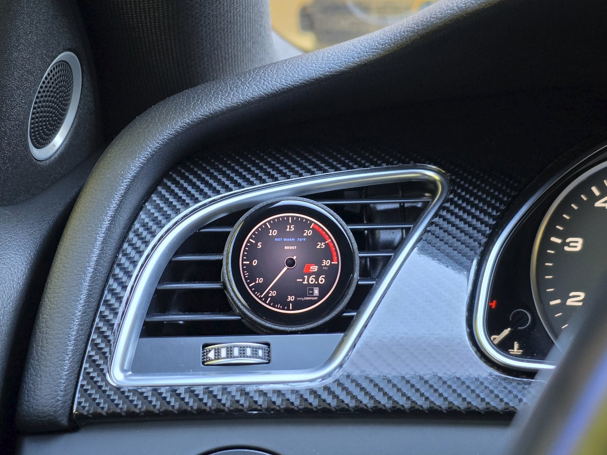
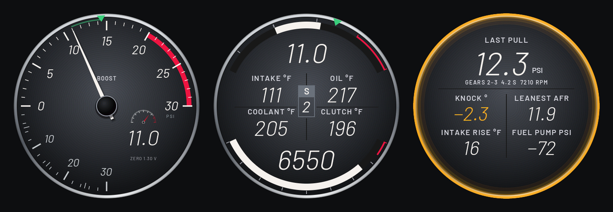
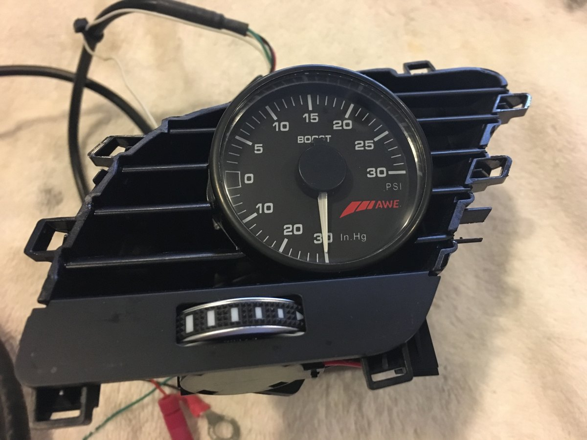
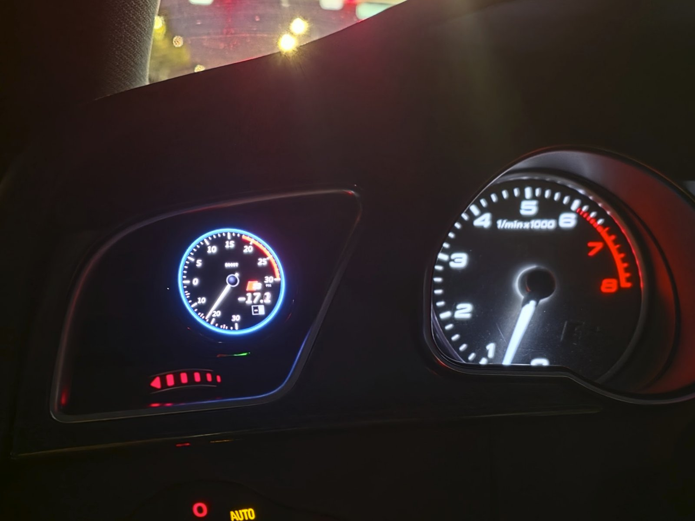
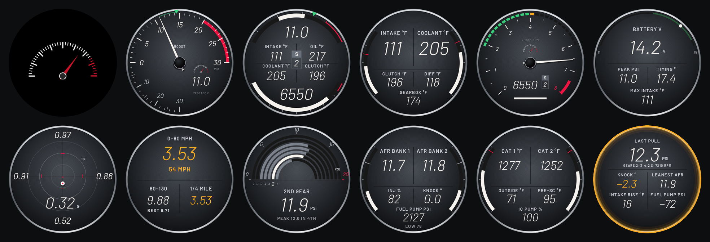
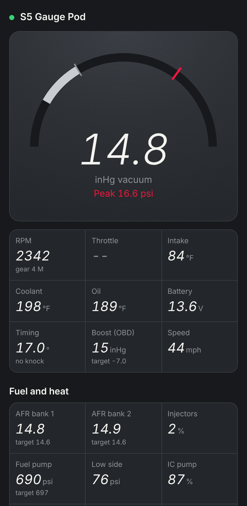
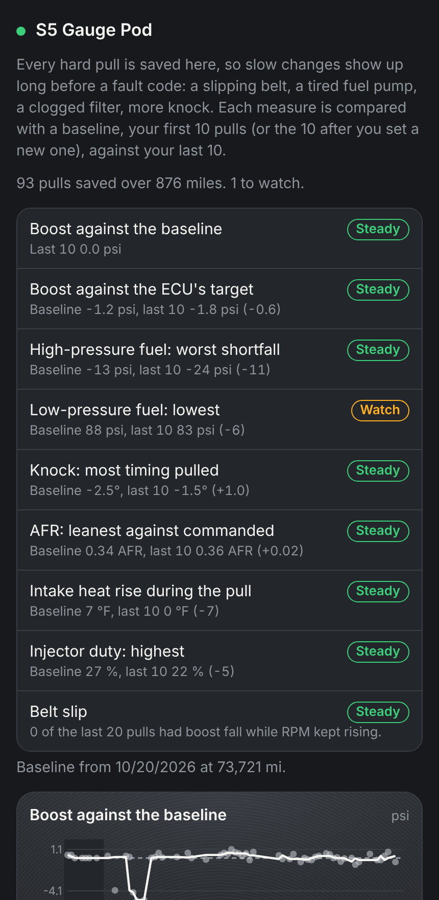
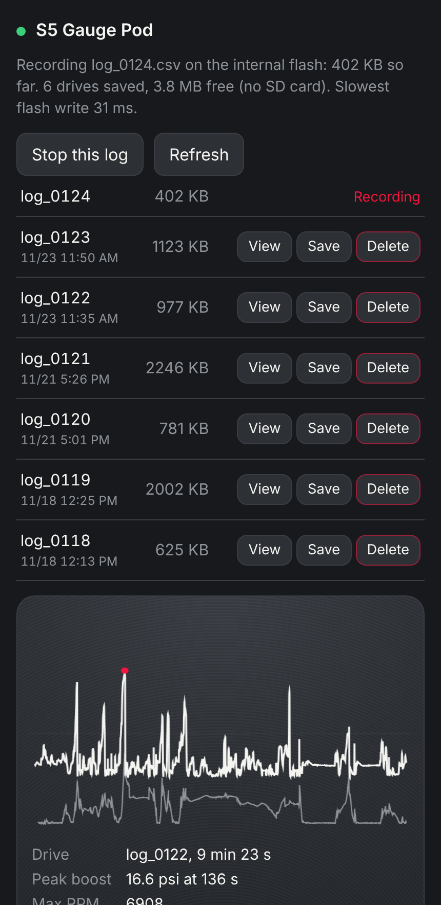
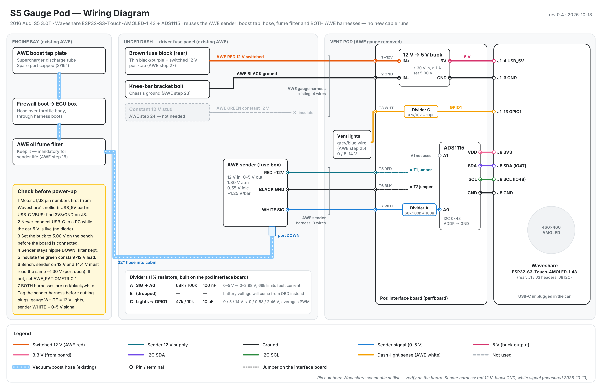

# Audi B8 / B8.5 OLED Vent Pod

<p align="center"></p>

A round 1.43″ AMOLED gauge for the driver's air vent of the B8 / B8.5 Audi S4 and S5, the spot where AWE Tuning's vent boost gauge goes. It reads boost from an analog sender 500 times a second, and more than 30 other engine, gearbox and differential readings over a Bluetooth OBD adapter. Eleven screens show it all, and it warns you when something looks wrong during a pull. It also logs every drive and serves a phone page for trends, logs, settings and firmware updates.

<p align="center"></p>

It started as a replacement for the dial of an AWE Tuning vent boost gauge and kept everything else from that kit: the boost tap, hose, fume filter, sender and both wiring harnesses. Nothing new runs through the dash.

**Status:** firmware 1.0, in daily use in a 2016 S5 3.0T since October 2026. It should fit any B8 / B8.5 S4 or S5 vent that takes the AWE gauge. The standard OBD readings work on any of them; the gearbox, differential and other Audi-specific identifiers were found on this one car and may differ on other engines, gearboxes and years (see [IDENTIFIERS.md](IDENTIFIERS.md)).

| Before: the AWE gauge it replaces | At night |
|---|---|
|  |  |

<sub>The photos show my car's build, which uses the car's own typeface and badge from the private folder (see *Fonts and the boot badge*); the repository builds with Barlow and a gauge badge, as in the renders below. At night the brightness follows the dash dimmer, and the blue ring means the oil isn't warm yet.</sub>

## The screens

Swipe to change screens, tap to dismiss a warning, hold 1 s to reset peaks, hold 3 s to re-zero the sender (engine off).



| Screen | What's on it |
|---|---|
| **Boost** | Analog-style dial, −30 inHg to 30 psi, with peak telltale, red zone, and a green arrow for the boost the ECU is asking for |
| **Overview** | Boost and RPM arcs, intake, oil, coolant and clutch oil temperatures, gear and D / S / M |
| **Temps** | Intake and coolant with arcs, plus clutch oil, gearbox and sport differential |
| **Engine** | Tachometer with a shift light, the pedal position and the gear |
| **System** | Battery, peak boost, timing, hottest intake; tap any small item to make it the big one |
| **G-force** | Friction circle with a trail and the peak in each direction |
| **Perf** | 0–60 mph, 60–130 mph and ¼ mile timers, with a launch-readiness check (oil warm, clutch not too hot, S or M, parking brake) |
| **Gears** | Peak boost reached in each gear |
| **Fuel** | AFR on both banks, injector duty, knock, high- and low-pressure fuel |
| **Heat** | Both catalyst temperatures, outside air, before-supercharger air, intercooler pump |
| **Last pull** | Summary after each hard pull: peak boost, gears, worst knock, leanest AFR, intake heat rise, fuel-pressure shortfall |

The screens are drawn by one piece of C++ (`gauge_render.h`). The same file compiles to WebAssembly for an interactive browser preview, [`docs/screen-mockup.html`](docs/screen-mockup.html): download it and open it locally to drive the gauges with sliders or a simulated drive.

## What it does

- **Boost from the analog sender.** An ADS1115 samples the AWE sender at about 500 Hz, with a median filter against loose-contact spikes. The sender is zeroed against the atmosphere at every key-on, and a small trim learned at idle lines it up with the ECU's manifold sensor. If the sender fails, OBD manifold pressure stands in.
- **OBD over Bluetooth LE.** A Veepeak BLE (ELM327) adapter gives about 19 answers a second. Half of them go to RPM and speed; the rest are shared by how overdue each reading is, weighted toward AFR, knock and fuel pressure during a pull. Readings come from the engine (Mode 01 and Mode 22), the gearbox, the sport differential and the steering module's clock. Every identifier, with its scaling and how it was confirmed, is in [IDENTIFIERS.md](IDENTIFIERS.md).
- **Warnings that don't cry wolf.** The pod warns for lean AFR, a high- or low-pressure fuel shortfall, knock under load, boost below the usual for that RPM, injector duty, and coolant, intake, battery and catalyst limits. Each rule was tuned against real drive logs so that shifts, lift-offs and tip-ins don't trigger it. A warning takes over the screen, and a tap dismisses it.
- **Pull summaries and health trends.** Every hard pull is summarised on screen and saved. Over weeks, the Health tab compares each measure against a baseline: boost at the same RPM, boost against target, fuel pressures, knock, AFR, intake heat rise, injector duty and belt slip. Each one is marked Steady, Watch or Worse.
- **Logging.** One CSV per drive at 10 samples a second, about 4 MB an hour, with 49 columns. Logs go to a microSD card if fitted, otherwise to the 9.9 MB internal flash, and are written so they never stutter the display on boost.
- **Phone page.** The pod runs its own Wi-Fi network; browse to `192.168.4.1`. Tabs: Live, Runs, Health, Logs (view a chart, download, delete), Settings, and OBD (polling statistics, a read-only console while moving, and a module / identifier finder).
- **Firmware updates over Wi-Fi.** Updates install from the phone. A new build runs on trial and the pod rolls back by itself if it doesn't run for 30 s.
- **Built for the car.** Brightness follows the dash dimmer, with an instant day / night switch on the headlights. The image drifts a pixel at a time against AMOLED burn-in. A blue warm-up ring shows until the oil reaches about 170 °F. Flash writes wait until you're off the throttle.

<p align="center">
  
  
  
</p>
<p align="center"><sub>The phone page: Live, Health (93 real pulls over 876 miles) and Logs</sub></p>

## Hardware

| Part | Notes |
|---|---|
| [Waveshare ESP32-S3-Touch-AMOLED-1.43](https://www.waveshare.com/wiki/ESP32-S3-Touch-AMOLED-1.43) | 466 × 466 round AMOLED, ESP32-S3R8, 16 MB flash, 8 MB PSRAM, touch, QMI8658 IMU (G-meter), PCF85063 RTC, microSD slot |
| ADS1115 breakout | 16-bit ADC on the board's I²C connector |
| 12 V → 5 V buck (Pololu D45V5F5) + Schottky diode | Feeds the board's 5 V pad from switched 12 V |
| Two resistor dividers | Sender signal (0–5 V → ADC) and the dash-light wire (0–14 V PWM → GPIO) |
| Veepeak OBDCheck BLE | Any ELM327 v1.5 adapter on **Bluetooth LE** (not Classic) should work |
| AWE Tuning vent boost gauge kit (B8 S4/S5) | Only its sender, boost tap, hose, fume filter and harnesses are used |



The full parts list, measurements, calibration, bring-up steps and the reasoning behind each choice are in [ENGINEERING.md](ENGINEERING.md). Point-to-point wiring and bench checks are in [WIRING.md](WIRING.md).

## Building the firmware

1. **Arduino IDE** with the **esp32** core 3.3.x (built and tested with 3.3.12).
2. Libraries from the Library Manager: **GFX Library for Arduino** (1.6.9), **Adafruit ADS1X15** (2.6.2), **NimBLE-Arduino** (2.x).
3. Open `firmware/S5GaugePod_Test/S5GaugePod_Test.ino` and set **Tools**:

   | Setting | Value |
   |---|---|
   | Board | ESP32S3 Dev Module |
   | USB CDC On Boot | Enabled |
   | Flash Size | 16MB |
   | Partition Scheme | 16M Flash (3MB APP/9.9MB FATFS) |
   | PSRAM | OPI PSRAM |

4. Every pin, threshold and default is in `config.h`. Change `WIFI_AP_PASS` before you build.
5. Flash the first build over USB. After that, use **Sketch → Export Compiled Binary** and install `S5GaugePod_Test.ino.bin` from the phone page (Settings → Firmware).

**Fonts and the boot badge.** The repository ships the [Barlow](https://github.com/google/fonts/tree/main/ofl/barlow) typeface (SIL Open Font License) and an original gauge badge. To use your own, generate them into `firmware/S5GaugePod_Test/private/`. Git ignores that folder, and the firmware uses whatever is there in place of the shipped files:

```sh
python3 tools/gen_fonts.py <folder with your .ttf files> firmware/S5GaugePod_Test/private/gauge_fonts.h audi
python3 tools/gen_badge.py my-badge.png firmware/S5GaugePod_Test/private/gauge_badge.h
```

## Tests and tools

Most of the logic runs on a desktop too, and each test file has its build line at the top:

```sh
g++ -std=c++17 -O2 -Ifirmware/S5GaugePod_Test tools/watch_test.cpp -o watch_test && ./watch_test
```

| Tool | What it checks |
|---|---|
| `tools/*_test.cpp` | OBD parsing, warnings and pull summaries, performance timers, gear estimate, G-meter calibration, logging (with a simulated SD card failing mid-drive), identifier finder, health history (including power cuts) |
| `tools/watch_replay.cpp` | Replays a real drive log through the warning rules |
| `tools/poll_check.py` | Simulates the OBD scheduler and fails if any reading could go stale on screen |
| `tools/sender_fit.py` | Fits the boost sender against the ECU's manifold pressure over whole drives: offset, slope or supply drift? |
| `tools/build_preview.sh` | Rebuilds the browser preview from `gauge_render.h` |

## Repository layout

```
├── README.md            this page
├── ENGINEERING.md       the full build record: parts, wiring, firmware design, calibration, version history
├── IDENTIFIERS.md       every OBD identifier used on this car
├── WIRING.md            point-to-point wiring and bench checks
├── docs/                wiring diagram, breadboard layout, screen preview, images
├── firmware/S5GaugePod_Test/   the Arduino sketch
└── tools/               desktop tests, generators, the phone page source (tools/web/index.html)
```

## Good to know

- **It only reads.** Normal polling uses read requests only (Mode 01, Mode 22). The OBD console can send anything, but only read requests while the car is moving; clearing codes, resets and adapter settings wait until it's stopped.
- **It is not a replacement for the car's own warnings,** and its thresholds are tuned for one car on one tune (034 Stage 2, 57.5 mm pulley). Check `config.h` before trusting the warnings on yours.
- **Mount it securely and set it up while parked.** It's meant to be read at a glance.
- **Change the Wi-Fi password** (`WIFI_AP_PASS`, or later in Settings): the default is in this repository for anyone to read.
- Identifiers outside Mode 01 were found on one 2016 S5 with the 0B5 S tronic and sport differential. Other years, gearboxes and options may differ; IDENTIFIERS.md says how each one was confirmed.

## Credits

- Screen typeface: [Barlow](https://github.com/google/fonts/tree/main/ofl/barlow) by Jeremy Tribby, SIL Open Font License 1.1 ([licence text](docs/licenses/OFL-Barlow.txt)).
- Board pinout and examples: [Waveshare wiki](https://www.waveshare.com/wiki/ESP32-S3-Touch-AMOLED-1.43).
- Libraries: GFX Library for Arduino (moononournation), Adafruit ADS1X15, NimBLE-Arduino (h2zero).

Not affiliated with or endorsed by Audi AG, AWE Tuning, Waveshare or Veepeak. Product names are used only to say what this works with.

## License

MIT, see [LICENSE](LICENSE). The Barlow typeface compiled into `gauge_fonts.h` stays under the SIL Open Font License ([docs/licenses/OFL-Barlow.txt](docs/licenses/OFL-Barlow.txt)).
